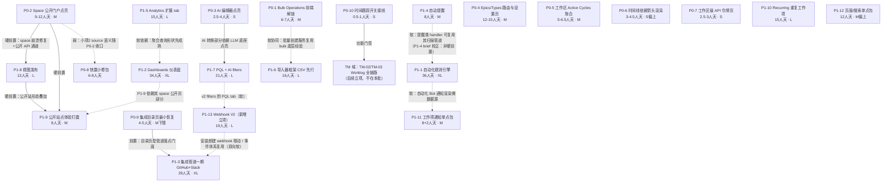
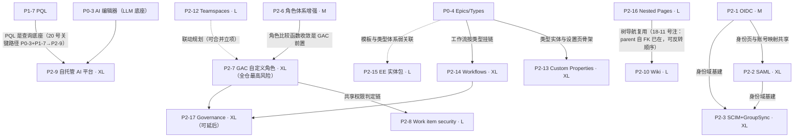

# 批次 3 任务 A（R5）改造切入点 · 总览与依赖图

> 基线：main HEAD `41af2176d7`（2026-11-14）｜汇总日期：2026-11-14
> 范围：本目录 24 份 Implementation Brief（P0-1~P0-10、P1-1~P1-13、P2-方案级汇总）的收尾汇总。
> 所有估算数字以各 brief 文件 §7「估算」为准；依赖关系以各 brief §6「依赖与（可）并行性」为准。

---

## 1. 总估算表

### 1.1 P0 组（10 份实现级 brief）｜合计 **50.5 - 66 人天**

| 编号     | 名称                           | 后端        | 前端          | 合计        | 段位                   | 上游冲突风险       |
| -------- | ------------------------------ | ----------- | ------------- | ----------- | ---------------------- | ------------------ |
| P0-1     | Bulk Operations 前端解锁       | 1.5-2       | 4-5           | **6-7**     | M                      | 中                 |
| P0-2     | Space 公开门户点亮             | 3-4         | 6-8           | **9-12**    | M                      | 中                 |
| P0-3     | AI 编辑器点亮                  | 0.5-1       | 2-3           | **2.5-4**   | S                      | 低-中              |
| P0-4     | Epics / Types 后端路由与设置页 | 4-5         | 8-10          | **12-15**   | M（贯穿另计 5-8，S-M） | 中                 |
| P0-5     | 工作区 Active Cycles 聚合端点  | 2-2.5       | 3-4           | **5-6.5**   | M                      | 低                 |
| P0-6     | 时间线依赖箭头渲染             | 0-0.5       | 3-4           | **3-4.5**   | S 偏上                 | 中                 |
| P0-7     | 工作区级 API 令牌页            | 1           | 1.5-2         | **2.5-3**   | S                      | 低                 |
| P0-8     | 快赢小修包（7 小项）           | 1           | 5-7           | **6-8**     | S 偏上                 | 中-高（editor 包） |
| P0-9     | 集成目录页最小恢复             | 0           | 4-5           | **4-5**     | M 下限                 | 低-中              |
| P0-10    | 时间跟踪开关接线（TM-01）      | 0           | 0.5-1         | **0.5-1**   | S 下限                 | 低                 |
| **合计** |                                | **13-16.5** | **37.5-49.5** | **50.5-66** |                        |                    |

注：若计入 P0-4 的「贯穿子项另计 5-8 人天」，P0 总量上限为 55.5-74。组代理回报的「≈52-66」与 brief 逐条加总（50.5-66）有 ±1.5 人天出入，**以 brief 文件为准**，本表按 brief 加总。

### 1.2 P1 组（13 份实现级 brief）｜合计 **234 人天**（一期口径）

| 编号     | 名称                           | 后端    | 前端    | 合计              | 段位                         | 上游冲突风险 |
| -------- | ------------------------------ | ------- | ------- | ----------------- | ---------------------------- | ------------ |
| P1-1     | 自定义自动化规则引擎           | 20      | 16      | **36**            | XL                           | 低-中        |
| P1-2     | Dashboards 可配置仪表盘        | 14      | 20      | **34**            | XL（一期）                   | 低           |
| P1-3     | 集成管道一期（GitHub + Slack） | 20      | 9       | **29**            | XL（一期）                   | 低           |
| P1-4     | 自动提醒                       | 6       | 2       | **8**             | M                            | 低           |
| P1-5     | Analytics 扩展 tab（2→7）      | 8       | 7       | **15**            | L                            | 中           |
| P1-6     | 导入器框架（CSV 先行）         | 10      | 6       | **16**            | L（一期下限）                | 低           |
| P1-7     | PQL + AI filters               | 14      | 7       | **21**            | L                            | 中           |
| P1-8     | 视图发布                       | 6       | 7       | **13**            | L（P0-2 完成后 ≈9-10，降 M） | 低-中        |
| P1-9     | 公开站点体验打磨               | 1       | 7       | **8**             | M                            | 低           |
| P1-10    | Recurring 重复工作项           | 9       | 6       | **15**            | L                            | 低           |
| P1-11    | 工作项通知单点包               | 2       | 4       | **8**（另联调 2） | M                            | 低           |
| P1-12    | 页面/搜索单点包                | 3       | 9       | **12**            | M 偏上                       | 低-中        |
| P1-13    | Webhook V2 升级（新增立项）    | 12      | 7       | **19**            | L                            | 中           |
| **合计** |                                | **125** | **109** | **234**           |                              |              |

注：二期限量另计——P1-2 二期 widget 批次 ~10-14；P1-3 二期 GitLab/Sentry/Bitbucket 各 +8-12；P1-6 Jira 完整版 +10-12。

### 1.3 P2 组（方案级，18 条）｜段位分布 M×3 + L×7 + XL×8

| 段位 | 条目                                                                                                                                                                   | 计  |
| ---- | ---------------------------------------------------------------------------------------------------------------------------------------------------------------------- | --- |
| M    | P2-1 OIDC SSO、P2-4 LDAP、P2-6 角色体系增强                                                                                                                            | 3   |
| L    | P2-5 审计日志、P2-8 Work item security、**P2-10 Wiki（XL→L）**、P2-11 Initiatives、P2-12 Teamspaces、P2-15 EE 实体包、P2-16 Nested Pages                               | 7   |
| XL   | **P2-2 SAML（L→XL）**、**P2-3 SCIM（L→XL）**、P2-7 GAC、P2-9 AI 平台、P2-13 Custom Properties、P2-14 Workflows、P2-17 Governance（可延后）、P2-18 计费体系（低优先级） | 8   |

P2 为方案级（每条 10-20 行，无逐条人天），段位口径 S=数天 / M=1-2 周 / L=2-6 周 / XL=6 周+。

### 1.4 总量速览

- 实现级（P0+P1 一期）：**≈284.5 - 300 人天**（P0 50.5-66 + P1 234）
- P2 18 条若全部立项：以段位中位粗估另需 30 周以上人力当量，其中 4 条明确低优先级/可延后（P2-17、P2-18、P2-2/P2-3 视商业化需求）。

---

## 2. 依赖关系图

### 2.1 P0 / P1 主图（23 节点 + TM 域外节点，13 条边，无环）

实线 = 硬前置；虚线 = 软依赖/弱协同。

图例说明：

- **无任何入边的节点**（P0-1、P0-3、P0-4、P0-5、P0-6、P0-7、P0-9、P0-10、P1-4、P1-5、P1-10、P1-12、P1-13）可立即并行启动。
- P1-9 是 P0-2 / P1-8 / P1-2 三者之上的**横向打磨层**，必须排在 Space 链最后（末端节点，无出边）。
- P1-9 / P0-10 / TM 是仅有的三个"纯出边"末端。

### 2.2 P2 关键边（17 节点，14 条边，无环）

校验：两图均无环（所有边指向下游段位；P2-16↔P2-10 的"互相复用"已按 brief 拆成单向 P2-16→P2-10 并注可反转）。

**编号勘误说明**：P1-7 与 P2-9 的 brief 原文写「前置 P0-4（LLM key 底座）」——按 P0-3 brief 头部（证据源标注「20 号路线图 P0-4」），LLM key 底座实际对应本批次编号的 **P0-3（AI 编辑器点亮）**；本总览已统一改为 P0-3→P1-7 / P0-3→P2-9。P0-4（Epics/Types）的下游是 P2-13/P2-14/P2-15，与 LLM 底座无关。

---

## 3. 并行批次建议

依据 §2 依赖图与各 brief §8 上游冲突面。**高危冲突区**（应错峰触碰、或按新文件隔离）：`packages/editor` src/core（P0-8 小项4、P2-16）、`apps/web` propel 迁移全域（#10038）、React19+RR8 升级面、`apps/api/plane/app/views/issue/` 与 `webhook_task.py`/`advance.py` 等安全修复高密度区。

| 批次                                                | 内容                                                                                                                                                                                                          | 理由与注意事项                                                                                                                                                                                            |
| --------------------------------------------------- | ------------------------------------------------------------------------------------------------------------------------------------------------------------------------------------------------------------- | --------------------------------------------------------------------------------------------------------------------------------------------------------------------------------------------------------- |
| **批次 α：P0 全域并行**（10 线，≈50.5-66 人天产能） | P0-1~P0-10 全部启动；仅两条软边：P0-8 小项 2 等 P0-2 的 source 语义收口、小项 4 建议避开 editor 包上游同步窗口；P0-7 与 P0-9 同改 `workspace.ts` 设置常量，**同批合并提交**减少冲突次数                       | P0 无任何硬内部前置（图 2.1 中 P0 仅有 P0-2→P0-8 一条弱边）；P0-10（0.5-1 人天）可搭车任何后端批次                                                                                                        |
| **批次 β：Space 发布链**（串行硬链）                | P0-2 → P1-8 → P1-9，三人日历上重叠滚动：P1-8 的 web 弹层部分可在 P0-2 验收后立即启动（P0-2 完成后 P1-8 由 13 降至 ≈9-10 人天）；P1-2 的 space 公开页部分与 P1-8 同期并行                                      | **全项目最大不确定点**：P0-2 崩溃根因未定位（±2 天波动），是整条链的闸门；P1-9 必须最后做（横向打磨层，叠 P0-2/P1-8/P1-2 公开页三者之上）                                                                 |
| **批次 γ：后端 XL 三线**                            | P1-1 自动化引擎、P1-2 Dashboards、P1-3 集成管道三条 XL 并行开发（后端契约先行，前端各配 1 人）；P1-10 Recurring 与 P1-1 **同批设计 beat/调度模块**；P1-4 自动提醒作为独立 beat 任务可先行交付（非引擎硬前置） | 三条 XL 相互零硬依赖、后端均为全新目录（新 urls/新模型），冲突面最低；唯一的共享风险点是 celery beat_schedule 与迁移 lockfile 的合并序（追加式改动）                                                      |
| **批次 δ：AI/PQL 链 + M/L 填充线**                  | 主线：P0-3 → P1-7 →（P1-13 v2 filters / P2-9 预研）；填充：P1-5 Analytics 扩展（先做，其聚合形状供 P1-2 复用）、P1-11、P1-12、P1-6 导入器框架                                                                 | P1-7 的 parser/编译器（后端 8 人天）可在 P0-3 未完成时先动手，仅 AI 转换部分等底座；P1-13 与 P1-3 存在安装联动软边，事件枚举以 62 号实测为准可先定稿；P1-5→P1-2 为软边，P1-5 排前可降低 P1-2 聚合引擎返工 |

建议节奏：α 批次全量启动的同时，β（1-2 人）、γ（3-4 人）、δ（2-3 人）按人力就位；γ 是人天大头（99 人天），应最先满编。

---

## 4. 编号对照说明（消除歧义）

### 4.1 P1 组 ↔ 20 号路线图 5.2 节对照表

本批次 P1 组编号按批次指令编排，与 20 号路线图 5.2 节存在错位（各 brief 头部已注明）。**项目内沟通一律以本批次编号为准**；引用 20 号原文时按下表换算：

| 本批次编号 | 名称                           | 20 号路线图 5.2 节编号           |
| ---------- | ------------------------------ | -------------------------------- |
| P1-1       | 自定义自动化规则引擎           | **P1-2**                         |
| P1-2       | Dashboards 可配置仪表盘        | **P1-3**                         |
| P1-3       | 集成管道一期（GitHub + Slack） | **P1-5**                         |
| P1-4       | 自动提醒                       | **P1-1**                         |
| P1-5       | Analytics 扩展 tab（2→7）      | **P1-4**                         |
| P1-6       | 导入器框架（CSV 先行）         | **P1-6**（一致）                 |
| P1-7       | PQL + AI filters               | **P1-7**（一致）                 |
| P1-8       | 视图发布                       | **P1-8**（一致）                 |
| P1-9       | 公开站点体验打磨               | **P1-9**（一致）                 |
| P1-10      | Recurring 重复工作项           | **P1-10**（一致）                |
| P1-11      | 工作项通知单点包               | 5.2 节通知单点项（无独立编号）   |
| P1-12      | 页面/搜索单点包                | 5.2 节搜索相关条目（无独立编号） |
| P1-13      | Webhook V2 升级                | **无对应条目——本批次新增立项**   |

错位要点：P1-1↔P1-4 互换（本批 P1-1=自动化、20 号 P1-1=自动提醒）；P1-2/P1-3 上移一位；P1-3（集成管道）对应 20 号 P1-5；P1-11/P1-12 为 20 号若干单点项的合并包。

### 4.2 P0 组对照备注

P0 组错位幅度小，但有一处需注意：**本批次 P0-3（AI 编辑器点亮）对应 20 号路线图 P0-4**（P0-3 brief 头部证据源注明）。由此产生的连带勘误见 §2.2 编号勘误说明——凡 brief 原文写「P0-4（LLM key 底座）」处，均指本批次 P0-3。

---

## 5. Top 风险清单

| #   | 风险                                                                                                                                                                                              | 影响范围                                                                   | 缓解                                                                                                                         |
| --- | ------------------------------------------------------------------------------------------------------------------------------------------------------------------------------------------------- | -------------------------------------------------------------------------- | ---------------------------------------------------------------------------------------------------------------------------- |
| 1   | **P0-2 space 发布崩溃根因未定位**（space 前端 6-8 人天含「崩溃排修（未知 bug 工作量波动）」，±2 天波动）                                                                                          | Space 全链（P0-2→P1-8→P1-9）的总闸门；P1-8 估算是按「P0-2 完成后降 M」计的 | 批次 β 第一周即投入排障；若 2 周未定位，P1-8/P1-9 估算按未降级口径（13 人天）重排                                            |
| 2   | **P1-1 AutomationRun 表结构为 UI 推断**（18 号 §1.4 标注「推断」，非高可信规格）                                                                                                                  | 自动化引擎 36 人天中执行/统计部分可能返工                                  | 先落 JSON 字段逃生门，执行记录先宽后收；二期图结构 automations 以本条表结构为基，表结构评审前置                              |
| 3   | **P1-2 Dashboard 前端不可恢复、需重写**（官方 2025-02 删除且考古无前端残件；仅后端 812 行旧视图可参考，省 ≈5 人天）                                                                               | 前端 20 人天为纯重写，无蓝本对拍风险                                       | 以 59 号 26 widget 目录+7 类实测逐个对拍云端形态；一期收窄为框架+高频 7 widget，19 种二期批次另计                            |
| 4   | **安全高密度文件的冲突隔离**：`webhook_task.py`（#9232/#9382 近期提交，P1-13）、`advance.py`/`build_chart.py`（P1-5）、`app/views/issue.py` 与 `api/views/issue.py`（P1-7）均为官方权限收口波及区 | P1-13 / P1-5 / P1-7 三条（风险：中），merge 冲突可放大工时                 | 统一隔离策略：外围加路由层/wrapper、独立 mixin/helper 文件、view 层 +3 行以内分发；迁移合并后立即 makemigrations 刷 lockfile |
| 5   | **`packages/editor` src/core 拆平刚完成**（#9719/#9723，官方高危同步区）                                                                                                                          | P0-8 小项 4（编辑器文案 i18n）、P2-16（三块类型扩展）                      | P0-8 小项 4 仅改显示名引用、可降级延后不阻塞其余；P2-16 块扩展走独立扩展文件、接入点最小 diff                                |
| 6   | **官方付费墙壳回补风险**：`use-bulk-operation-status.ts`（P0-1）、`use-view-publish.tsx` stub（P1-8）、active-cycles 升级壳（P0-5）——官方商业策略若变可能重写这些文件                             | P0-1 / P1-8 / P0-5 的 hook 与壳文件被静默覆盖                              | 同签名重写 stub、新增独立 hook（不直改原文件）、CI 加 grep 断言哨兵（P0-1 brief §9.1）                                       |
| 7   | **P2-7 GAC 为全仓最高风险项**（权限判定链遍布每个 viewset，官方安全波持续）                                                                                                                       | P2-7 及其下游 P2-8/P2-17                                                   | 判定函数单点替换、新增权限层不动旧装饰器签名；P2-6 Owner 档先行收敛比较函数；建议排 P2 尾段                                  |

---

## 6. 与 20 号路线图的段位/范围修正

| 项                              | 20 号原判定                                       | 本批次修正                                                           | 依据                                                                                                                   |
| ------------------------------- | ------------------------------------------------- | -------------------------------------------------------------------- | ---------------------------------------------------------------------------------------------------------------------- |
| Wiki（P2-10）                   | XL                                                | **L（下调）**                                                        | 18-11 号：CE Page 已是 workspace 级、parent/is_global/PageLabel/PageVersion 地基全在，缺的只是 Collection 两表+容器 UI |
| SAML SSO（P2-2）                | L                                                 | **XL（上调）**                                                       | 17 号考古：全仓零 SAML 痕迹、无可复用地基，需 python3-saml 全链路+企业 IdP 联调矩阵                                    |
| SCIM + GroupSync（P2-3）        | L                                                 | **XL（上调）**                                                       | 同上：全仓零 SCIM 痕迹（GroupSync 规格虽已备，SCIM 网关从零建）                                                        |
| Webhook V2（P1-13）             | 无独立条目                                        | **新增立项**（19 人天，L）                                           | 17 号考古对象 8：ProjectWebhook 模型已加未接线；62 号 D-03/D-05/D-06 云端实测枚举                                      |
| 时间跟踪开关（P0-10）           | 13 号遗留表第 2 条（不在 P0 档）                  | **新进 P0**（TM-01，0.5-1 人天）                                     | 13 号 539 行「工作量极小」判定成立；是 TM 域（TM-02/TM-03 Worklog 全链路）的功能门控                                   |
| P1-4 自动提醒与 P1-1 引擎的关系 | 20 号曾提「P1-1 是 P1-2 引擎的邮件/调度基建前置」 | **校正：非硬前置**——提醒是独立 beat 任务，引擎仅可后续复用其扫描管道 | P1-4 brief §6 校正说明                                                                                                 |
| P1-8 视图发布                   | L                                                 | **P0-2 完成后降 M**（13 → ≈9-10 人天）                               | P1-8 brief §6：space 匿名路由/部署模式/anchor 流验证后不确定性收敛                                                     |

其余条目段位维持 20 号判定（P2 详表见 P2-方案级汇总.md 头部说明）。

---

## 7. 数据来源

本总览的全部估算、依赖、风险与段位修正均取自以下 24 份 brief（目录 `docs/01.追赶正式版/01.功能调研/16.改造切入点/`，基线 main `41af2176d7`，2026-11-14）：

**P0 组（10）**：P0-1-Bulk-Operations前端解锁.md、P0-2-Space公开门户点亮.md、P0-3-AI编辑器点亮.md、P0-4-Epics与Types后端路由及设置页.md、P0-5-工作区Active-Cycles聚合端点.md、P0-6-时间线依赖箭头渲染.md、P0-7-工作区级API令牌页.md、P0-8-快赢小修包.md、P0-9-集成目录页最小恢复.md、P0-10-时间跟踪开关接线.md

**P1 组（13）**：P1-1-自定义自动化规则引擎.md、P1-2-Dashboards可配置仪表盘.md、P1-3-集成管道一期GitHub与Slack.md、P1-4-自动提醒.md、P1-5-Analytics扩展tab.md、P1-6-导入器框架CSV先行.md、P1-7-PQL与AI-filters.md、P1-8-视图发布.md、P1-9-公开站点体验.md、P1-10-Recurring重复工作项.md、P1-11-工作项通知单点包.md、P1-12-页面搜索通知单点包.md、P1-13-Webhook-V2升级.md

**P2 组（1）**：P2-方案级汇总.md

—— 汇总日期：2026-11-14
