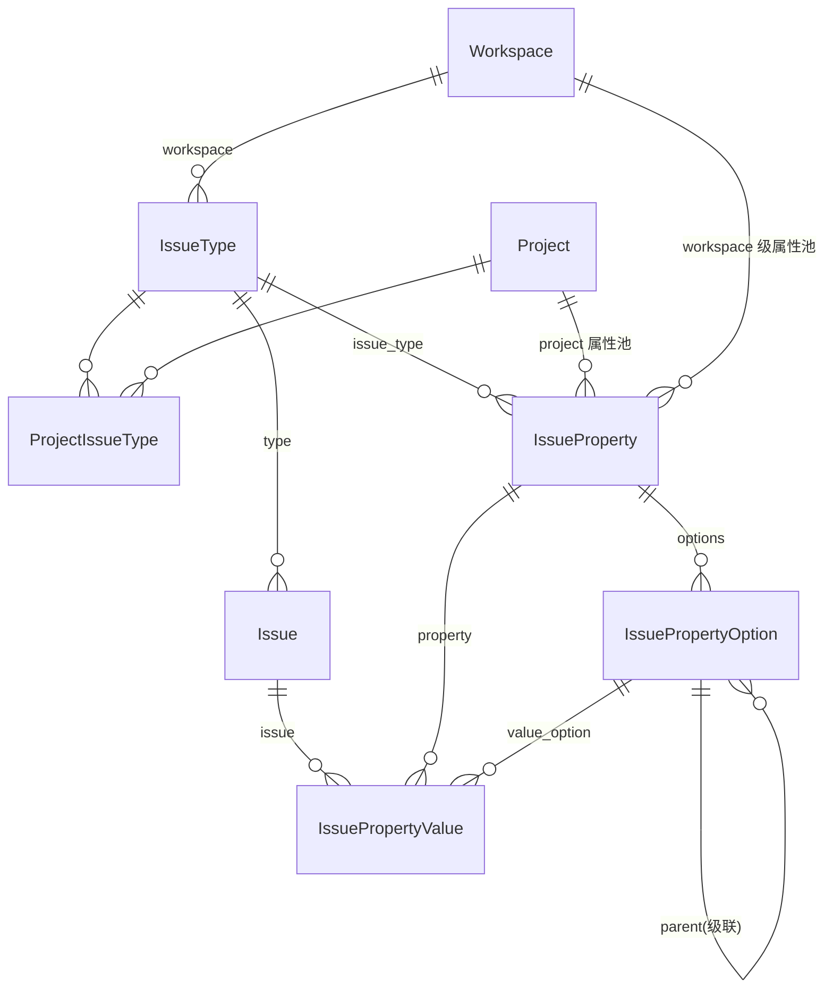

# 01. 工作项类型与自定义属性（数据模型与 API 规格草案）

> 依据：SDK `plane/models/work_item_types.py`、`work_item_properties.py`、`work_item_property_configurations.py`、`work_item_type_governance.py`、`models/v2/work_item_types.py`（高）；UI 实测 57 号文档（高-中）；CE 代码（高）。PQL 中 `cf["<uuid>"]` 自定义属性过滤（mcp-server `pql_reference.py`）。

## 1. 实体与字段

### 1.1 WorkItemType（工作项类型，workspace 级 + project 关联桥）

| 字段                           | 类型         | 约束/默认                                                          | 说明                                               | 可信度              |
| ------------------------------ | ------------ | ------------------------------------------------------------------ | -------------------------------------------------- | ------------------- |
| id                             | UUID PK      | -                                                                  | -                                                  | 高                  |
| workspace                      | FK→Workspace | CASCADE                                                            | 类型是工作区级资源，经 `ProjectIssueType` 挂到项目 | 高（CE 已有，同构） |
| name                           | varchar(255) | 必填                                                               | -                                                  | 高                  |
| description                    | text         | 可空                                                               | -                                                  | 高                  |
| logo_props                     | JSON         | default dict                                                       | 图标+背景色（UI 图标选择器写入）                   | 高                  |
| is_epic                        | boolean      | default false                                                      | Epic 特殊类型标记                                  | 高                  |
| is_active                      | boolean      | default true（UI 新建默认禁用→业务层默认 false 的表现差异，见 §7） | 启用状态；启用后不可禁用（UI 警告文案）            | 高                  |
| is_default                     | boolean      | default false                                                      | 项目内默认类型（`ProjectIssueType.is_default`）    | 高                  |
| level                          | float/int    | default 0                                                          | 层级深度：Epic=1，普通=0（57 号层级 tab 实证）     | 高                  |
| project_ids / ProjectIssueType | M2M 桥       | unique(project, issue_type, deleted_at null)                       | + 桥上 `level`、`is_default`                       | 高                  |
| external_source / external_id  | varchar(255) | 可空                                                               | 外部同步                                           | 高                  |

### 1.2 IssueProperty（自定义属性定义）

| 字段                          | 类型                    | 约束/枚举                                                                                                                                                                                                                                                                        | 说明                                                                                             | 可信度                 |
| ----------------------------- | ----------------------- | -------------------------------------------------------------------------------------------------------------------------------------------------------------------------------------------------------------------------------------------------------------------------------- | ------------------------------------------------------------------------------------------------ | ---------------------- |
| id                            | UUID PK                 | -                                                                                                                                                                                                                                                                                | -                                                                                                | 高                     |
| workspace / project           | FK                      | 可空 project（workspace 级属性池存在：v2 有 `/workspaces/{slug}/work-item-properties/` 与项目级两组路径）                                                                                                                                                                        | -                                                                                                | 高                     |
| issue_type                    | FK→IssueType            | 可空（项目属性池未绑定时为 null）                                                                                                                                                                                                                                                | 绑定后进入该类型 schema                                                                          | 高                     |
| name                          | varchar                 | 内部名                                                                                                                                                                                                                                                                           | -                                                                                                | 高                     |
| display_name                  | varchar                 | **必填**                                                                                                                                                                                                                                                                         | UI 显示名（创建弹窗「标题」）                                                                    | 高                     |
| description                   | text                    | 可空                                                                                                                                                                                                                                                                             | -                                                                                                | 高                     |
| property_type                 | enum                    | `TEXT/DATETIME/DECIMAL/BOOLEAN/OPTION/RELATION/URL/EMAIL/FILE/FORMULA/CASCADING`                                                                                                                                                                                                 | UI 实测 8 类（文本/数字/下拉/布尔/日期/成员/富文本/URL）；SDK 多出 FORMULA、CASCADING（UI 未见） | 高                     |
| relation_type                 | enum                    | `ISSUE/USER/RELEASE/RICH_TEXT`                                                                                                                                                                                                                                                   | RELATION 属性必填；成员选择器=USER，富文本=RICH_TEXT，关联工作项=ISSUE                           | 高                     |
| is_active                     | boolean                 | -                                                                                                                                                                                                                                                                                | UI「活动」复选，默认不勾                                                                         | 高                     |
| is_required                   | boolean                 | default false                                                                                                                                                                                                                                                                    | UI「必填属性」                                                                                   | 高                     |
| is_multi                      | boolean                 | default false                                                                                                                                                                                                                                                                    | 下拉/成员的「多选」开关                                                                          | 高                     |
| default_value                 | list[str]               | 可空                                                                                                                                                                                                                                                                             | 选项 UUID 或文本                                                                                 | 高                     |
| sort_order                    | float                   | -                                                                                                                                                                                                                                                                                | 列表排序                                                                                         | 高                     |
| settings                      | JSON                    | TEXT→`{display_format: single-line/multi-line/readonly}`；DATETIME→`{display_format: MMM dd,yyyy/dd/MM/yyyy/MM/dd/yyyy/yyyy/MM/dd}`；DECIMAL 的格式(standard/percent/currency)、小数位、千位分隔符为 UI 子配置（SDK settings 模型只定义了 TEXT/DATETIME 两类，其余为 free JSON） | 高/中                                                                                            | 高                     |
| validation_rules              | JSON                    | 可空                                                                                                                                                                                                                                                                             | -                                                                                                | 中（SDK 有、语义未定） |
| options                       | M2M→IssuePropertyOption | -                                                                                                                                                                                                                                                                                | -                                                                                                | 高                     |
| external_source / external_id | varchar                 | -                                                                                                                                                                                                                                                                                | -                                                                                                | 高                     |

### 1.3 IssuePropertyOption（选项）

| 字段                     | 类型      | 说明                                  | 可信度 |
| ------------------------ | --------- | ------------------------------------- | ------ |
| id                       | UUID      | -                                     | 高     |
| name                     | varchar   | 必填（UI 回车成 chip）                | 高     |
| description / logo_props | text/JSON | 可空                                  | 高     |
| sort_order               | float     | -                                     | 高     |
| is_active / is_default   | boolean   | 默认值选项                            | 高     |
| property / parent        | FK        | parent 支持级联选项（对应 CASCADING） | 高     |

### 1.4 IssuePropertyValue（属性值，EAV）

| 字段                                                                     | 类型      | 说明                                                                 | 可信度                                   |
| ------------------------------------------------------------------------ | --------- | -------------------------------------------------------------------- | ---------------------------------------- |
| id                                                                       | UUID      | -                                                                    | 高                                       |
| issue / property                                                         | FK        | unique(issue, property)（单值属性）                                  | 中（unique 约束为推断，is_multi 时多行） |
| value_text / value_boolean / value_decimal / value_datetime / value_uuid | 各类型列  | 按 property_type 落列；OPTION/RELATION 落 value_uuid 或 value_option | 高                                       |
| value_option                                                             | FK→Option | -                                                                    | 高                                       |
| external_id / external_source                                            | varchar   | -                                                                    | 高                                       |

响应封装（v2 `WorkItemPropertyValueDetail`）：`{id, property_id, issue_id, value, value_type, value_detail?(富文本 {description_html, description_stripped}), external_id, external_source, created_at, updated_at}`。

### 1.5 TypeGovernance（类型治理，Enterprise，轻量记录）

`mode: any|constrained|required`、`required_workflow_id`、`allowlist[workflow_id]`、pins（project→workflow 钉选）、preview（变更 dry-run 返回 total/type_total/per_state）、state_mapping（孤儿工作项状态迁移映射）。属工作流域的挂接面，本域只登记端点。

## 2. 关系图

## 3. 端点表（v2，路径前缀 `/api/v2`）

权限：项目成员（Admin/Member 可写，Guest 只读）；feature flag：workspace `is_work_item_types_enabled`（一次性启用、不可禁用，57 号 UI 警告文案）。

| 方法                  | 路径                                                                                                                             | 入参                                               | 出参                                           | flag                 | 可信度                                  |
| --------------------- | -------------------------------------------------------------------------------------------------------------------------------- | -------------------------------------------------- | ---------------------------------------------- | -------------------- | --------------------------------------- | --- |
| GET                   | `/workspaces/{slug}/work-item-types/`                                                                                            | 分页                                               | WorkItemType[]                                 | workspace flag       | 高                                      |
| POST                  | 同上                                                                                                                             | name, description?, is*active?, external*\*        | WorkItemType                                   |                      | 高                                      |
| GET/PATCH/DELETE      | `.../work-item-types/{id}/`                                                                                                      | -                                                  | WorkItemType                                   |                      | 高                                      |
| POST                  | `.../work-item-types/mark-default/`（op `workspace_work_item_types_mark_default`）                                               | type_id                                            | -                                              |                      | 高                                      |
| POST                  | `.../projects/{project_id}/work-item-types/`                                                                                     | 同上                                               |                                                |                      | 高                                      |
| POST                  | `.../work-item-types/import/`（op `work_item_types_import`，MCP `import_to_project`）                                            | `{work_item_types: [id]}`                          |                                                |                      | 高                                      |
| POST                  | `.../work-item-types/enable/`（op `work_item_types_enable`）                                                                     | -                                                  | 项目启用（自动建 Epic+Task）                   |                      | 高                                      |
| POST                  | `.../work-item-types/{id}/mark-default/`                                                                                         | -                                                  |                                                |                      | 高                                      |
| GET                   | `.../work-item-types/{id}/schema/`（op `work_item_types_schema`）                                                                | -                                                  | `{type_id,type_name,...,fields,custom_fields}` |                      | 高                                      |
| GET/POST/PATCH/DELETE | `.../work-item-types/{type_id}/properties/`（workspace/project 两组）                                                            | `{properties:[id]}`（attach）                      | WorkItemProperty[]                             |                      | 高                                      |
| POST                  | `.../work-item-type-properties/{id}/attach                                                                                       | detach/`                                           | `{properties:[...]}`                           | `{properties:[...]}` |                                         | 高  |
| GET/POST/PATCH/DELETE | `/workspaces/{slug}/work-item-properties/` 及 `/projects/{id}/work-item-properties/`                                             | IssueProperty                                      |                                                |                      | 高                                      |
| 同上                  | `.../work-item-properties/{id}/options/`                                                                                         | Option                                             |                                                |                      | 高                                      |
| 同上                  | `.../work-item-properties/{id}/contexts/`                                                                                        | -                                                  | property context（项目/类型绑定上下文）        |                      | 高                                      |
| GET                   | `.../work-items/{id}/property-values/`（SDK work_item_properties.values）                                                        | -                                                  | PropertyValueDetail[]                          |                      | 高                                      |
| POST/PUT              | `.../work-items/{id}/property-values/{property_id}/`                                                                             | `{value}`（类型依 property_type；multi 可传 list） | PropertyValueDetail[]                          |                      | 高                                      |
| GET                   | `/workspaces/{slug}/work-item-relation-definitions/`                                                                             | -                                                  | RELATION 属性可选目标定义                      |                      | 高                                      |
| 治理组                | `.../work-item-types/{id}/governance/`、`/preview/`、`/workflow-pins/`、project `/workflow-pick/`、`/workflow-fallback-preview/` | UpdateTypeGovernance                               | GovernancePreview 等                           |                      | 高（SDK api/work_item_type_governance） |

## 4. 与 CE 对照

| 对象                       | CE 现状                                                                                                                                                                                                                   | 结论                                                                                           |
| -------------------------- | ------------------------------------------------------------------------------------------------------------------------------------------------------------------------------------------------------------------------- | ---------------------------------------------------------------------------------------------- |
| IssueType/ProjectIssueType | **模型已在**：`apps/api/plane/db/models/issue_type.py:14/35`，字段与 EE 读模型完全同构（is*epic/is_default/is_active/level/external*\*）；`Project.is_issue_type_enabled`（`project.py:101`）                             | **复用**模型，**新建** CRUD 序列化器+ViewSet（CE 无任何路由，`plane/api/urls/` 无 issue_type） |
| IssueProperty/Option/Value | **完全无**。迁移考古：`0071_rename_issueproperty_issueuserproperty_and_more.py` 把旧 IssueProperty 改名 IssueUserProperty→`0114` 再改 ProjectUserProperty（现 `db/models/project.py:392`，是用户显示偏好，非属性 schema） | **新建** 3 表 + 值读写全链路                                                                   |
| 属性类型面                 | UI 8 类 vs SDK 11 类（+FORMULA/CASCADING）                                                                                                                                                                                | 先实现 UI 8 类，schema 预留 FORMULA/CASCADING 枚举位                                           |
| 设置页                     | `/work-item-types/` 路由 404（57 号实拍）                                                                                                                                                                                 | web 新建管理页                                                                                 |

## 5. 迁移与数据兼容

1. 新表命名对齐官方猜测值：`issue_properties` / `issue_property_options` / `issue_property_values`（EE 真实表名不可考，冲突预案见下）。
2. **升级官方 schema 冲突预案**：官方若发布 CE 版属性表且表名不同，用 `RenameModel` + 数据搬迁迁移收敛；追赶表不写死 DB 层 unique 约束于值表（is_multi 语义下用 partial unique：单值属性 unique(issue,property) where value_option is null 风格，便于与官方语义并轨）。
3. `Issue.type` FK 已存在（`db/models/issue.py` `type = FK("db.IssueType")`），类型切换的「值并入描述」业务（57 号确认弹窗语义）在服务层实现，不动 schema。
4. 启用开关：`Project.is_issue_type_enabled` 已在；workspace 级开关若官方为 workspace feature 单例，追赶用 `Workspace` 表加列或 workspace feature JSON，避免新建单例表。

## 6. SDK 有但 UI 未见的字段（单列）

| 字段/能力                                                        | 出处                                     | 可信度                |
| ---------------------------------------------------------------- | ---------------------------------------- | --------------------- |
| property_type `FORMULA`、`CASCADING`                             | SDK enums.py PropertyType                | 高（存在）/低（语义） |
| relation_type `RELEASE`（属性关联到 Release 实体）               | SDK enums.py RelationType                | 高                    |
| `validation_rules`（校验规则 JSON）                              | SDK work_item_properties.py              | 中                    |
| WorkItemType `deleted_at`（SDK 读模型带，UI 无软删入口）         | SDK v1 模型                              | 高                    |
| 属性 `contexts`（属性在不同类型/项目的启用上下文实体）           | SDK api/work_item_properties/contexts.py | 中                    |
| governance 模式（any/constrained/required）与 workflow pins      | SDK work_item_type_governance.py         | 高（Enterprise 域）   |
| `work_item_type_default_level`（workspace feature 上的默认层级） | SDK v2/features.py                       | 高                    |

## 7. 依据与可信度汇总

- 高：全部实体字段名/类型（SDK 模型逐字段）；v2 op id 与路径（`_generated/constants.py` + 资源类 `path`）；CE 模型/迁移考古。
- 中：settings 的 DECIMAL 子配置 schema（UI 表单推断，SDK 未定义结构）；值表 unique 语义。
- 低：EE 真实 DB 表名；FORMULA/CASCADING 语义。
