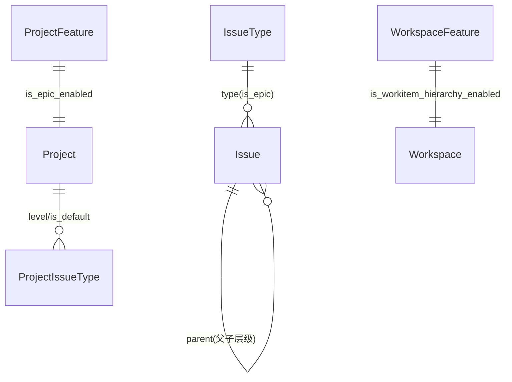

# 02. 层级与 Epics（数据模型与 API 规格草案）

> 依据：SDK `models/epics.py`、`models/work_items.py`（Epic 模型字段与 work_items 的 `parent`/`type_id`/`is_epic`）、`models/v2/work_items.py`、UI 57 号（层级 tab、Epic 子项类型排除）、12 号盘（`is_epic_enabled`/`is_workitem_hierarchy_enabled` feature）。PQL `isEpic()/isTopLevel()/isSubWorkItem()/hasChildren()/childOf()/parentOf()`（mcp-server）。

## 1. 实体与字段

### 1.1 Epic（Epic 工作项）

Epic 不是独立表：**Epic = 带 `type.is_epic=true` 类型的 Issue**。SDK Epic 读模型暴露的字段面（即 Epic API 返回的超集）：

| 字段                                                                              | 类型    | 说明                                       | 可信度 |
| --------------------------------------------------------------------------------- | ------- | ------------------------------------------ | ------ |
| （继承 Issue 全部字段）                                                           | -       | 见 `apps/api/plane/db/models/issue.py:104` | 高     |
| parent                                                                            | FK→self | Epic 也可有 parent（跨类型父子）           | 高     |
| state / priority / start_date / target_date / assignees / labels / estimate_point | 常规    | -                                          | 高     |
| sequence_id / sort_order / completed_at / archived_at / is_draft                  | -       | -                                          | 高     |
| type（EpicIssue 模型里为 `type_id`）                                              | FK      | Epic 专属 type                             | 高     |

Create/Update Epic 请求：`name, description_html?, state_id?, parent_id?, assignee_ids?, label_ids?, priority?, start_date?, target_date?, estimate_point?, external_*`。

### 1.2 层级规则（无独立表，规则面）

| 规则         | 内容                                                                                                        | 依据                   |
| ------------ | ----------------------------------------------------------------------------------------------------------- | ---------------------- |
| 层级值       | IssueType.level：Epic=1，Task/自定义=0（57 号层级 tab 实测可视化「层级 1：Epic → 层级 0：Task/调研-缺陷」） | 中                     |
| 子项类型排除 | Epic 下创建子项时类型下拉排除 Epic（父链上位类型），只列 level 更低的类型                                   | 中（57 号 3.4 步骤 9） |
| 可配置性     | 层级 tab 本批未发现编辑入口；SDK 有 `work_item_type_default_level`（workspace feature）暗示层级深度可配     | 中/低                  |
| feature      | project `is_epic_enabled`（Epic 布局/入口）；workspace `is_workitem_hierarchy_enabled`（层级能力总开关）    | 高（SDK features.py）  |

## 2. 关系图

## 3. 端点表（v2）

| 方法             | 路径（SDK api/epics + v2 work_items）                                                 | 入参       | 出参                            | flag              | 可信度                                       |
| ---------------- | ------------------------------------------------------------------------------------- | ---------- | ------------------------------- | ----------------- | -------------------------------------------- |
| GET              | `/workspaces/{slug}/projects/{project_id}/epics/`                                     | 分页+筛选  | Epic[]（PaginatedEpicResponse） | `is_epic_enabled` | 高                                           |
| POST             | 同上                                                                                  | CreateEpic | Epic                            |                   | 高                                           |
| GET/PATCH/DELETE | `.../epics/{id}/`                                                                     | UpdateEpic | Epic                            |                   | 高                                           |
| GET/POST/DELETE  | `.../epics/{id}/work-items/`（AddEpicWorkItems `{work_item_ids}`）                    | -          | EpicIssue[]（分页）             |                   | 高                                           |
| GET              | `.../work-items/?parent=<id>`（通用父过滤）                                           | parent     | WorkItem[]                      |                   | 高（CE v1 已有 parent filter）               |
| GET              | `.../work-items/{id}/sub-work-items/`（若官方独立子项端点，PQL hasChildren 语义对应） | -          | WorkItem[]                      |                   | 低（端点存在性未证，可先复用 parent filter） |

## 4. 与 CE 对照

| 对象         | CE 现状                                                                                    | 结论                                                                                |
| ------------ | ------------------------------------------------------------------------------------------ | ----------------------------------------------------------------------------------- |
| 父子层级     | `Issue.parent`（self FK，`db/models/issue.py:111`）已在；v1 work_item API 支持 parent 读写 | **复用**                                                                            |
| Epic         | `IssueType.is_epic` 字段在；CE 无 Epic 布局/端点                                           | **扩展**：新增 epics 视图端点（实为 Issue 查询 + type.is_epic 过滤）；web Epic 布局 |
| 层级排除规则 | CE 无实现                                                                                  | 新建服务层规则（按 IssueType.level 过滤可选类型）                                   |
| feature 开关 | CE `Project` 无 `is_epic_enabled`                                                          | 新建 project feature 面（见 10 号文档统一方案）                                     |

## 5. 迁移与数据兼容

1. 无新表需求（Epic=Issue+type），**追赶成本集中在服务/UI 层**。
2. 兼容策略：保持 `parent` 无环校验（官方未见 schema 约束，建议服务层防环 + 深度限制跟随 IssueType.level）。升级官方时若官方引入独立 `work_item_hierarchy` 配置表，只影响规则读取层，不影响 Issue 数据。
3. Epic 的 sequence/进度：直接复用 Issue 的 IssueSequence 与状态聚合，无需新表。

## 6. SDK 有但 UI 未见字段

| 字段                                                                                | 出处                     | 可信度 |
| ----------------------------------------------------------------------------------- | ------------------------ | ------ |
| Epic `deleted_at`、`point`（SDK Epic 模型带 point 整数，UI 未见 Epic 单独点数字段） | models/epics.py          | 中     |
| EpicIssue `last_activity_at`                                                        | models/epics.py          | 高     |
| `is_draft` 在 Epic 读模型（UI Epic 无草稿概念）                                     | models/epics.py          | 高     |
| PQL `isTopLevel()/isSubWorkItem()/hasChildren()` 谓词（证明层级是 v2 查询一等能力） | mcp-server pql_reference | 高     |

## 7. 依据与可信度汇总

高：SDK Epic 模型与端点、CE parent 字段、feature toggle 名。中：层级 tab 规则语义、类型排除规则。低：sub-work-items 独立端点、层级深度可配置。
