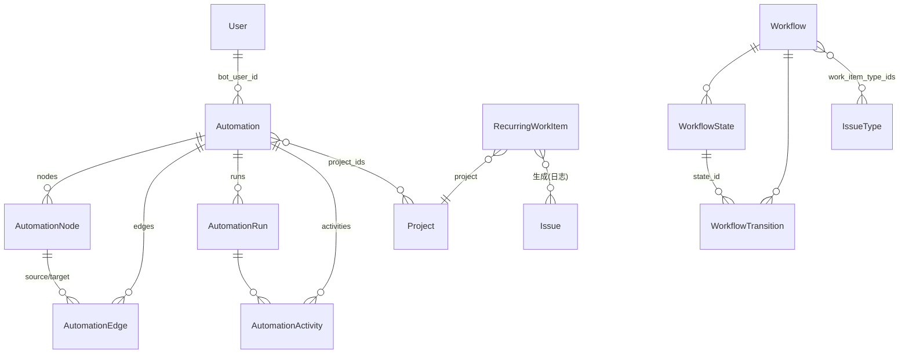

# 03. 重复工作项与自动化（数据模型与 API 规格草案）

> 依据：SDK `models/v2/automations.py`（Automation/Node/Edge/Activity 全模型，高）、`models/v2/workflows.py`（审批流，高）、UI 58 号实测（触发器 5/条件 6/操作 5、重复项表单，中-高）、CE 代码（高）。注意：UI 的「自定义自动化」表单面与 SDK 的 Automation 图模型（nodes/edges）并存——SDK 暴露的是 v2 画布底层结构，UI 是其简化投影。

## 1. 实体与字段

### 1.1 Automation（自动化规则壳）

| 字段                                | 类型         | 约束/枚举                                          | 说明                                                | 可信度 |
| ----------------------------------- | ------------ | -------------------------------------------------- | --------------------------------------------------- | ------ |
| id                                  | UUID         | -                                                  | -                                                   | 高     |
| name                                | varchar      | **必填**                                           | UI 创建弹窗第一步                                   | 高     |
| description                         | text         | 可空                                               | -                                                   | 高     |
| scope                               | varchar      | 必填；如 `"WorkItem"/"Cycle"/"Module"`（SDK 注释） | 规则作用实体                                        | 高     |
| status                              | enum         | `draft / published / disabled`                     | UI 状态列=活动 ↔ published+is_enabled               | 高     |
| is_enabled                          | boolean      | -                                                  | 启用开关由独立 `status` action 写                   | 高     |
| is_global                           | boolean      | -                                                  | 工作区级规则（v2 有 workspace 与 project 两组路径） | 高     |
| project_ids                         | list[FK]     | 可空                                               | 多项目规则                                          | 高     |
| bot_user_id                         | FK→User      | 可空                                               | 执行者（UI 实测=Automation Bot 身份写活动流）       | 高     |
| current_version_id                  | FK           | -                                                  | 规则版本化（nodes/edges 带 version_id）             | 高     |
| run_count / last_run_at             | int/datetime | -                                                  | UI「执行次数/最后运行时间」                         | 高     |
| created_at/updated_at/created_by_id | -            | -                                                  | -                                                   | 高     |

### 1.2 AutomationNode（触发器/条件/操作节点）

| 字段                                  | 类型     | 说明                                                                                                                                                                                                                 | 可信度                                      |
| ------------------------------------- | -------- | -------------------------------------------------------------------------------------------------------------------------------------------------------------------------------------------------------------------- | ------------------------------------------- |
| id / automation（经 version）         | UUID     | -                                                                                                                                                                                                                    | 高                                          |
| node_type                             | enum     | `trigger / action / condition`                                                                                                                                                                                       | 高                                          |
| handler_name                          | varchar  | 触发器如 `record_created`；操作如 `send_email`（SDK 注释）；UI 面 5 触发器=Work item created/updated、State changed、Assignee changed、Comment created；5 操作=add comment/add link/change properties/delete/archive | 高（结构）/中（handler 枚举与 UI 对齐关系） |
| config                                | JSON     | 节点配置自由体：触发器→事件名；条件→`{property, operator, value[]}`（UI 运算符锁定 is，6 字段 State/Type/Label/Assignees/Created by/Priority）；操作→`{property, operation: add/remove, value}` 等                   | 高（结构）/中（config 内部键）              |
| is_enabled                            | boolean  | -                                                                                                                                                                                                                    | 高                                          |
| next_scheduled_at / last_triggered_at | datetime | 仅调度型触发器                                                                                                                                                                                                       | 高                                          |
| version_id                            | FK       | -                                                                                                                                                                                                                    | 高                                          |

### 1.3 AutomationEdge（节点连线）

`id, source_node_id, target_node_id, execution_order（同源多边评估顺序）, version_id, created_by_id`——trigger→condition→action 的 DAG。UI 画布「如果→那么」是单链特例。

### 1.4 AutomationActivity / AutomationRun（活动与运行）

- Activity：`id, verb, field, old_value/new_value, old_identifier/new_identifier, actor_id, automation_id/node_id/edge_id/run_id, node_execution_id, epoch, scope, version_id`（高）。
- Run：UI 侧证「运行记录卡片：触发工作项 ID·时间·耗时·成功/失败」「列表执行次数 1/2、成功率、平均持续时间 150-300ms」→ 推断存在 AutomationRun 表（`triggered_by(work_item) / status / duration_ms / started_at`）。**表结构为推断，可信度低**。
- Webhook secret：节点级 `regenerate_webhook_secret` action 返回 `{secret}`——自动化可被外部 webhook 触发（高）。

### 1.5 RecurringWorkItem（重复工作项，独立产品面）

| 字段                     | 类型          | 约束                                                            | 说明                                          | 可信度     |
| ------------------------ | ------------- | --------------------------------------------------------------- | --------------------------------------------- | ---------- |
| id                       | UUID          | -                                                               | -                                             | 中（结构） |
| name                     | varchar       | 必填                                                            | UI「标题」                                    | 中         |
| description_html         | text          | 可空                                                            | -                                             | 中         |
| project / work_item_type | FK            | 类型默认 Task                                                   | -                                             | 中         |
| 预置属性                 | JSON 或 FK 组 | 状态(默认 Backlog)/优先级/负责人/标签                           | UI 属性 chips                                 | 中         |
| start_date               | date          | **必填**（UI 红框校验）                                         | 当天立即生成首个工作项                        | 中         |
| end_date                 | date          | 可空                                                            | -                                             | 中         |
| recurrence               | enum          | `DAILY/WEEKLY/MONTHLY/YEARLY/CUSTOM`                            | UI repeats 5 项；CUSTOM 子配置未展开（cron?） | 中         |
| 活动区                   | -             | 「successfully created a recurring work item SURVEY-4」生成历史 | 需生成日志表                                  | 中         |

SDK 无 recurrence 模型（grep 零命中）——重复项在 v2 407 ops 中未暴露为独立资源，推断由 AutomationNode 的调度型触发器（next_scheduled_at）承载或未上 v2 API。**追赶按独立实体设计，落库为 `recurring_work_items` + 生成日志**。

### 1.6 Workflow（审批工作流，Business 只读壳/Enterprise 全量）

- Workflow：`id, name, description, is_active, is_default, work_item_type_ids[]`。
- WorkflowState：state 挂链（`state_id, type, is_default, allow_issue_creation`）。
- WorkflowTransition：`transition_state_id, rejection_state_id, required_approvals, member_ids[]`（审批人）、hooks（`phase: pre/post, handler_name, rule_type, execution_order, config{url|script_id}`）。
- 提交审批：`SubmitWorkItemApproval {type: approve|reject}` → `WorkItemApprovalResult {state_id}`。
- WorkspaceWorkflow：工作区目录（catalog states 链、usage 报告、项目钉选）。
- Business 档：单一 Default Workflow 只读+启停+变更历史（58 号 1.3 实测）；流转规则/允许新建/审批配置均 Enterprise。

## 2. 关系图

## 3. 端点表（v2）

| 方法                  | 路径                                                                     | op                                                 | 说明                        | flag                         | 可信度 |
| --------------------- | ------------------------------------------------------------------------ | -------------------------------------------------- | --------------------------- | ---------------------------- | ------ |
| GET/POST              | `/workspaces/{slug}/projects/{id}/automations/`                          | project_automations_list/create                    | 项目级规则                  |                              | 高     |
| GET/PATCH/DELETE      | `.../automations/{id}/`                                                  | retrieve/partial_update/destroy                    | 删除需先禁用（UI 文案）     |                              | 高     |
| POST                  | `.../automations/{id}/status/`                                           | project_automations_status                         | `{is_enabled}` 唯一启停通道 |                              | 高     |
| GET/POST/PATCH/DELETE | `.../automations/{id}/nodes/`                                            | project*automation_nodes*\*                        |                             |                              | 高     |
| POST                  | `.../nodes/{id}/regenerate-webhook-secret/`                              | project_automation_nodes_regenerate_webhook_secret | →`{secret}`                 |                              | 高     |
| GET/POST/PATCH/DELETE | `.../automations/{id}/edges/`                                            | project*automation_edges*\*                        |                             |                              | 高     |
| GET                   | `.../automations/{id}/activities/`                                       | project_automation_activities_list                 |                             |                              | 高     |
| 同 8 条               | `/workspaces/{slug}/automations/...`                                     | workspace*automations*\*                           | 工作区级（is_global）       |                              | 高     |
| -                     | 重复工作项                                                               | **v2 无 op**                                       | 独立产品面，追赶自建 CRUD   | `is_workflow_enabled?`（中） | 中     |
| GET/POST              | `.../workflows/`、`.../workflows/{id}/states/`、`.../state-transitions/` | workflows/workflow_states/workflow_transitions     | 审批流配置                  | `is_workflow_enabled`        | 高     |

## 4. 与 CE 对照

| 对象       | CE 现状                                                                                                                 | 结论                                                     |
| ---------- | ----------------------------------------------------------------------------------------------------------------------- | -------------------------------------------------------- |
| 自动化引擎 | 无（`apps/web/components/automation/` 仅 2 内置开关组件 510 行；后端 `Project.automation` JSON 内 archive_in/close_in） | **新建**全链路（模型+Celery 执行+活动）                  |
| 内置规则   | CE「自动归档/自动关闭」开关在 UI，数据落 Project 字段                                                                   | **保留**为内置 handler，收敛到 Automation 模型的系统规则 |
| 异步执行   | CE 有 Celery/beat（`plane/celery.py`），活动流支持系统 actor 需扩展（IssueActivity actor 指向 Bot user）                | 复用队列                                                 |
| 工作流     | CE 无                                                                                                                   | 新建；Business 等级先做 Default Workflow 壳              |
| 重复工作项 | 全仓库零命中                                                                                                            | 新建实体+beat 调度                                       |

## 5. 迁移与数据兼容

1. 新表：`automations / automation_nodes / automation_edges / automation_activities`（+ 猜测 `automation_runs`、`recurring_work_items`）。
2. 官方升级冲突预案：nodes/edges 的 `config` 保持 JSONField（官方即自由 JSON），表结构冲突概率低；`handler_name` 枚举保持字符串不设 choices，官方新 handler 不需要迁移。
3. CE 内置开关字段（`Project.close_in/archive_in` 等）保留不动，UI 层改读 Automation 系统规则，数据迁移一次性脚本把两开关转成两条系统 Automation（可回滚：仅追加不删字段）。
4. 事件时刻评估语义（58 号 D-07）：条件在事件 payload 快照上评估，执行引擎入口接 issue post_save/post_delete 信号→ Celery 任务。

## 6. SDK 有但 UI 未见

| 字段/能力                                                                 | 出处                   | 可信度                                |
| ------------------------------------------------------------------------- | ---------------------- | ------------------------------------- |
| Automation `scope` 支持 Cycle/Module（非 WorkItem 作用域）                | v2/automations.py 注释 | 高                                    |
| 节点 webhook 触发（regenerate_webhook_secret）                            | v2/automations.py      | 高                                    |
| 规则版本化（current_version_id/version_id）                               | v2/automations.py      | 高                                    |
| workspace 级全局自动化                                                    | v2 路径组              | 高                                    |
| WorkflowTransitionHook（pre/post phase、send_webhook/run_script handler） | v1 workflows.py        | 高                                    |
| WorkspaceWorkflow 的 usage 报告/referenced_resources                      | workspace_workflows.py | 高                                    |
| 重复工作项（v2 无 API、SDK 无模型）——UI 独有                              | 58 号                  | 中（实体）/低（与 Automation 的关系） |

## 7. 依据与可信度汇总

高：Automation/Node/Edge/Activity/Workflow 全字段、v2 op 与路径、CE 缺失证据。中：handler 枚举与 UI 的映射、RecurringWorkItem 字段（UI 推断）、Run 表结构。低：AutomationRun 精确字段、CUSTOM 频率子配置。
