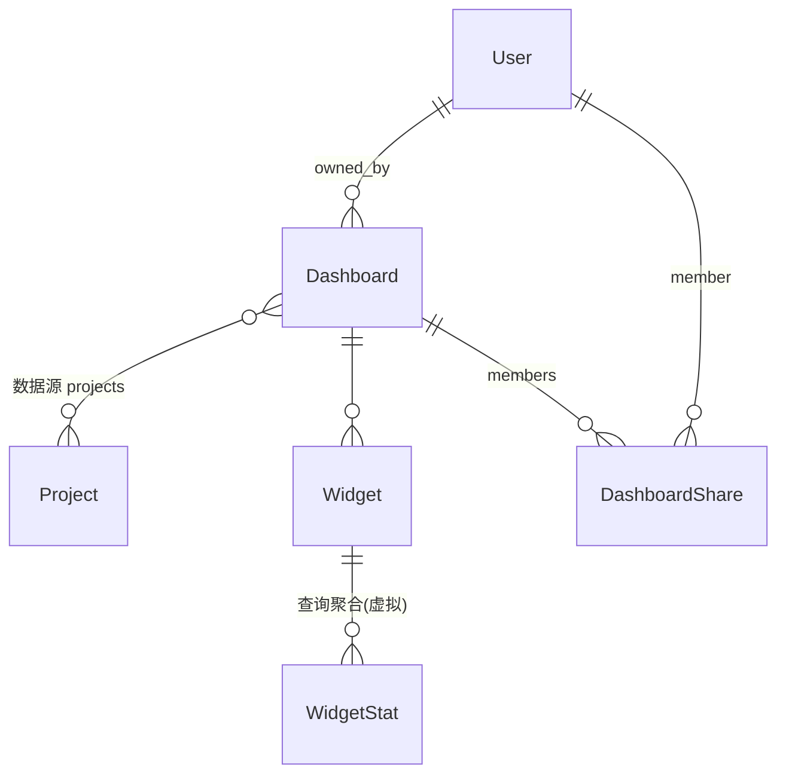

# 04. Dashboards 与 Widgets（数据模型与 API 规格草案）

> 依据：UI 59 号实测（创建弹窗/widget 目录 26 种/布局/分享/发布 sites.plane.so/导出 PDF，中-高）；CE 死代码与端点考古（高）；SDK v2 无 dashboards op（`_generated/constants.py` 无 dashboard 资源——**说明 Dashboards 未进 v2 公开 API**，规格主要靠 UI 反推，整体可信度中）。

## 1. 实体与字段

### 1.1 Dashboard（仪表板）

| 字段                          | 类型             | 约束/默认                                               | 说明                                                                           | 可信度   |
| ----------------------------- | ---------------- | ------------------------------------------------------- | ------------------------------------------------------------------------------ | -------- |
| id                            | UUID             | -                                                       | -                                                                              | 中       |
| name                          | varchar          | **必填**                                                | 占位示例「跨项目容量」等                                                       | 中（UI） |
| projects                      | M2M→Project      | **必填多选**                                            | 数据源（无「全工作区」选项）                                                   | 中       |
| filters                       | JSON             | 可空                                                    | 数据源级筛选：Basic（结构同视图筛选）/ PQL（自然语言→PQL 编译，59 号 PQL tab） | 中       |
| visibility                    | enum             | `public(工作区所有人可见)/private(仅本人)`，默认 public | 列表页 公开/私有/共享 三 tab → 推断第三态 shared=被成员分享                    | 中       |
| is_published / publish_anchor | boolean/char(32) | anchor=32 位 hex，unique                                | 发布后生成 `sites.plane.so/dashboards/{anchor}`；重新生成=停用旧链             | 中       |
| owned_by                      | FK               | -                                                       | 所有者                                                                         | 中       |
| created_at/updated_at         | -                | -                                                       | -                                                                              | 中       |

### 1.2 Widget（组件）

| 字段        | 类型    | 说明                                                                                                                                                                                                                                                                                                                                                                                                           | 可信度                                                                                                                                                                                                                                              |
| ----------- | ------- | -------------------------------------------------------------------------------------------------------------------------------------------------------------------------------------------------------------------------------------------------------------------------------------------------------------------------------------------------------------------------------------------------------------- | --------------------------------------------------------------------------------------------------------------------------------------------------------------------------------------------------------------------------------------------------- | ------------------- |
| id          | UUID    | -                                                                                                                                                                                                                                                                                                                                                                                                              | 中                                                                                                                                                                                                                                                  |
| dashboard   | FK      | -                                                                                                                                                                                                                                                                                                                                                                                                              | 中                                                                                                                                                                                                                                                  |
| name        | varchar | 默认「New widget」，保存后自动「Y vs X」                                                                                                                                                                                                                                                                                                                                                                       | 中                                                                                                                                                                                                                                                  |
| widget_type | enum    | 26 种目录值（UI 分组 9 类）：bar/grouped-bar/stacked-bar/line/multi-line/area/compare-area/stacked-area/pie/donut/progress-donut/smart-counter/smart-gauge/statistics/table-2d/work-item-table/assigned-to-you/work-item-progress/cycle-progress/active-cycle-progress/intake-by-source/intake-retention/intake-avg-accept-reject/intake-accepted-vs-rejected/intake-breakdown 等（枚举值未知，UI 目录名实录） | 中                                                                                                                                                                                                                                                  |
| config      | JSON    | 图表类：`{x_axis: property, y_axis: metric(count                                                                                                                                                                                                                                                                                                                                                               | estimate), max_points(20)}`；计数器：`{group_by, metric, max_rows(6), style}`；二维表：`{row, column}`；表格：`{columns[], max_rows(10)}`；X 轴属性 15 种（状态/状态组/标签/负责人/估算/周期/模块/优先级/类型/项目/开始/截止/创建于/完成于/创建者） | 中（UI 全字段实测） |
| style       | JSON    | `{color:#049BDC, legend:bool, tooltip:bool, visualization}`                                                                                                                                                                                                                                                                                                                                                    | 中                                                                                                                                                                                                                                                  |
| filters     | JSON    | widget 级 Basic/PQL 筛选                                                                                                                                                                                                                                                                                                                                                                                       | 中                                                                                                                                                                                                                                                  |

### 1.3 DashboardShare（分享/访问）

| 字段                    | 类型 | 说明                                                  | 可信度 |
| ----------------------- | ---- | ----------------------------------------------------- | ------ |
| id / dashboard / member | -    | 成员级授权；「有访问权限的人员」列表                  | 中     |
| access                  | enum | 共享 tab「常规访问：所有人/受限」（受限档位名未展开） | 中     |
| owner                   | -    | 创建者天然所有                                        | 中     |

### 1.4 WidgetStat / 导出

- widget 数据查询：按 config 聚合（对照 CE 首页 home-dashboard 的 widget stats 端点模式）；导出=PDF（另存为/方向 纵横向）——服务端渲染任务表可复用 ExporterHistory（`db/models/exporter.py`）。
- 「创建副本」：后端复制接口。

## 2. 关系图

## 3. 端点表（无 v2 op，UI/CE 死代码反推，均中可信度）

| 方法             | 路径（草案）                                      | 入参                                   | 出参            | 说明                     | 可信度                                 |
| ---------------- | ------------------------------------------------- | -------------------------------------- | --------------- | ------------------------ | -------------------------------------- |
| GET              | `/api/workspaces/{slug}/dashboards/?visibility=`  | tab 过滤/搜索                          | Dashboard[]     | 公开/私有/共享           | 中                                     |
| POST             | `/api/workspaces/{slug}/dashboards/`              | name, project_ids, filters, visibility | Dashboard       |                          | 中                                     |
| GET/PATCH/DELETE | `.../dashboards/{id}/`                            | -                                      | Dashboard       |                          | 中                                     |
| POST             | `.../dashboards/{id}/duplicate/`                  | -                                      | Dashboard       | 创建副本                 | 低                                     |
| POST             | `.../dashboards/{id}/publish/`                    | -                                      | `{anchor,url}`  | 重新生成同端点           | 中                                     |
| DELETE           | `.../dashboards/{id}/publish/`                    | -                                      | -               | 取消发布                 | 中                                     |
| GET              | `.../dashboards/{id}/widgets/`、POST/PATCH/DELETE | Widget                                 |                 | 布局拖拽=PATCH sort/size | 中                                     |
| GET              | `.../widgets/{id}/stats/`                         | filters                                | 聚合数据        |                          | 中（模式参照 CE home dashboard stats） |
| POST             | `.../dashboards/{id}/members/`                    | member                                 | DashboardShare  |                          | 低                                     |
| POST             | `.../dashboards/{id}/export/`                     | `{orientation}`                        | ExporterHistory | PDF                      | 低                                     |
| GET              | 公开 `/dashboards/{anchor}/`（space 域，匿名）    | -                                      | 只读投影        |                          | 中（59 号实测公开页）                  |

CE 已存在参照端点：`apps/api/plane/app/urls/user.py:80` `users/me/workspaces/{slug}/dashboard/?dashboard_type=home`（首页只读）。

## 4. 与 CE 对照

| 对象                  | CE 现状                                                                                                                                                                                     | 结论                                                         |
| --------------------- | ------------------------------------------------------------------------------------------------------------------------------------------------------------------------------------------- | ------------------------------------------------------------ |
| Dashboard/Widget 模型 | **无**（`db/models/` 无 dashboard 模型；仅 workspace.py 命中单词）                                                                                                                          | **新建**                                                     |
| 前端死代码            | `apps/web/services/dashboard.service.ts` 的 `getDashboardDetails/getWidgetStats/updateWidget` 指向不存在的 `/api/dashboard/{id}` 端点；`THomeDashboardResponse/TWidget` 类型与 store 骨架在 | **复用** service/store 骨架接新端点（成本低，59 号 §6 结论） |
| 聚合数据源            | CE `apps/api/plane/app/views/` 分析视图（analytics）已实现工作项聚合查询                                                                                                                    | widget stats 后端可复用 analytics 查询管道                   |
| 公开页                | CE space（:3002）已有 DeployBoard 公开路由模式                                                                                                                                              | 复用 space 匿名路由 + anchor 寻址                            |

## 5. 迁移与数据兼容

1. 新表 `dashboards / dashboard_widgets / dashboard_members`（表名猜测，冲突预案同 00 号总则：列结构对齐 BaseModel 基类）。
2. widget config 全 JSON，官方结构演进不需要迁移；`widget_type` 存字符串。
3. 发布 anchor 复用 DeployBoard 的 `get_anchor()`（`db/models/deploy_board.py:14` uuid4().hex）模式。
4. 升级官方冲突面：官方若在 v2 暴露 dashboards（当前未暴露），路径大概率 `/workspaces/{slug}/dashboards/`，追赶同路径放置可平滑。

## 6. SDK 有但 UI 未见字段

SDK **完全没有** dashboards 资源（407 ops 无一命中）——本域「SDK 有但 UI 未见」为空，反向成立：**UI 有而 SDK 未封装**（云端 dashboards 走 web 内部 API 而非公开 v2）。此为本域最大不确定点，标注为低可信度风险。

## 7. 依据与可信度汇总

高：CE 死代码/端点考古。中：全部实体字段（UI 反推）、端点草案。低：分享 access 档位、导出格式全集、duplicate 端点。
