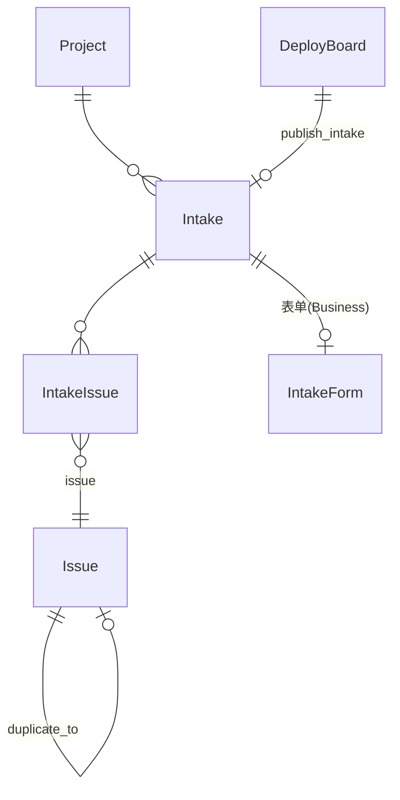

# 05. Intake 公开提交（数据模型与 API 规格草案）

> 依据：SDK `models/intake.py`、`models/v2/intakes.py`（高）；CE `db/models/intake.py`（高）；UI 55 号（U6 收件箱/公开提交）、53 号（Intake 发布）；官方 pricing（Intake In-app=Free、Forms/Email=Business）。

## 1. 实体与字段

### 1.1 Intake（收集队列，CE 已有）

| 字段                    | 类型         | 约束                                   | 可信度 |
| ----------------------- | ------------ | -------------------------------------- | ------ |
| id                      | UUID PK      | -                                      | 高     |
| project                 | FK           | -                                      | 高     |
| name                    | varchar(255) | unique(name, project, deleted_at null) | 高     |
| description             | text         | -                                      | 高     |
| is_default              | boolean      | default false                          | 高     |
| view_props / logo_props | JSON         | default dict                           | 高     |

### 1.2 IntakeIssue（收集条目，CE 已有，字段面与 v2 读模型一致）

| 字段                          | 类型         | 约束/枚举                                                                     | 说明                                   | 可信度                |
| ----------------------------- | ------------ | ----------------------------------------------------------------------------- | -------------------------------------- | --------------------- |
| id                            | UUID         | -                                                                             | -                                      | 高                    |
| intake / issue                | FK           | CASCADE                                                                       | issue 为投影工作项                     | 高                    |
| status                        | int enum     | `-2 PENDING / -1 REJECTED / 0 SNOOzed / 1 ACCEPTED / 2 DUPLICATE`，default -2 | v2 Literal `[-2..2]` 一致              | 高                    |
| snoozed_till                  | datetime     | null；保存时按项目时区归整到当日 00:00（CE 已实现）；snoozed 部分索引         | 高                                     |
| duplicate_to                  | FK→Issue     | SET_NULL                                                                      | -                                      | 高                    |
| source                        | varchar(255) | default `IN_APP`（SourceType 仅 IN_APP）                                      | Business 版扩展：form/email/webhook 等 | 高（CE）/中（扩展值） |
| source_email                  | text         | 邮件通道来信地址                                                              | 高（字段在，语义=邮件通道占位）        | 高                    |
| extra                         | JSON         | 公开表单附加数据                                                              | 高                                     |
| external_id / external_source | varchar      | -                                                                             | 高                                     |

### 1.3 IntakeForm（表单定义，Business 档，UI 推断）

| 字段                  | 类型 | 说明                                                    | 可信度 |
| --------------------- | ---- | ------------------------------------------------------- | ------ |
| id / intake           | -    | 与 Intake 1:1 或 1:N                                    | 低     |
| form_fields           | JSON | 表单 schema（字段→必填/顺序/类型；对应创建公开表单 UI） | 低     |
| is_published / anchor | -    | 公开提交页（对照 DeployBoard intake 类型发布）          | 中     |

## 2. 关系图

## 3. 端点表

权限：项目成员管理；公开提交匿名（经 DeployBoard 发布页）。flag：CE `Project.intake_view`（default False）；Business 分层：In-app 免费、表单/邮件 Business。

| 方法             | 路径                                                                               | 入参                                                                      | 出参                                 | 说明                                                 | 可信度            |
| ---------------- | ---------------------------------------------------------------------------------- | ------------------------------------------------------------------------- | ------------------------------------ | ---------------------------------------------------- | ----------------- |
| GET/POST         | `/api/v1/workspaces/{slug}/projects/{id}/intake/`（CE 已有，`api/urls/intake.py`） | Intake                                                                    | Intake[]                             | 队列 CRUD                                            | 高                |
| GET              | `.../intake/{intake_id}/work-items/`                                               | 分页                                                                      | IntakeIssue[]（expand issue_detail） | v2 同构 `intakes_list`                               | 高                |
| POST             | `.../intake/{intake_id}/work-items/`                                               | `{issue: {name, description_html, priority?, ...}}`                       | IntakeWorkItem                       | 公开提交入口（匿名经发布页；v2 op `intakes_create`） | 高                |
| GET/PATCH/DELETE | `.../intake/{intake_id}/work-items/{id}/`                                          | UpdateIntakeWorkItem（status/snoozed_till/duplicate_to 可与字段同 PATCH） | IntakeWorkItem                       | v2 把 v1 的独立 status 端点折叠进 PATCH              | 高                |
| POST             | `.../intake/{id}/work-items/{id}/status/`（v1 CE 形态）                            | `{status}`                                                                | -                                    | 接受/拒绝/暂停/重复                                  | 高                |
| GET              | `.../intake-work-items/{id}/duplicate/`（v1）                                      | -                                                                         | 候选                                 | 查重                                                 | 高（CE 有此语义） |
| 公开             | `/api/public/space/{anchor}/intake/…`（space 域）                                  | 表单字段                                                                  | -                                    | 公开提交（CE space intake 路由已在）                 | 高（CE 存在）     |
| GET/POST/PATCH   | `.../intake-form/`（Business 表单定义）                                            | IntakeForm                                                                | -                                    | **追赶新增**                                         | 低                |
| 邮件通道         | `POST /api/workspaces/{slug}/intake-email/inbound/`（占位）                        | 邮件解析 payload                                                          | IntakeIssue                          | source=email，source_email 落库                      | 低（占位）        |

## 4. 与 CE 对照

| 对象                    | CE 现状                                                               | 结论                                                                                  |
| ----------------------- | --------------------------------------------------------------------- | ------------------------------------------------------------------------------------- |
| Intake/IntakeIssue 模型 | **已在**（`db/models/intake.py:16/54`，含状态枚举/暂停归整/部分索引） | **复用**                                                                              |
| Intake 管理 API         | `api/urls/intake.py` 已有 v1 路由                                     | **复用**                                                                              |
| source 扩展             | SourceType 仅 `IN_APP`                                                | **扩展**：加 `FORM/EMAIL`（不再改 choices 结构，直接放宽 CharField 语义即可，无迁移） |
| 公开提交                | space 前端已支持 Intake 发布（55 号 U6 走通）                         | **复用**                                                                              |
| IntakeForm              | 无                                                                    | **新建**（Business 档，可延后）                                                       |

## 5. 迁移与数据兼容

1. CE 模型与 v2 读模型字段一一对应，**无需迁移**即可实现 v2 语义（PATCH 折叠 status 端点是序列化器层工作）。
2. IntakeForm 若新建，挂 `intake` FK + JSON schema；官方升级若引入表单表， RenameModel 收敛。
3. source_email 语义核对：CE 该字段已存在（`intake.py:77`），邮件通道只需入站解析任务 + 新 SourceType 值。
4. 风险：CE `IntakeIssue.extra` 为 dict 默认，公开表单提交的附件/结构化字段放 extra，避免官方升级时列冲突。

## 6. SDK 有但 UI 未见字段

| 字段                                                                                          | 出处             | 可信度 |
| --------------------------------------------------------------------------------------------- | ---------------- | ------ |
| `extra`（提交附加 JSON）在 v1 IntakeWorkItem 读模型显式存在                                   | models/intake.py | 高     |
| v2 读模型 `state_id`、`work_item_id`、`intake_id` 直接展开（v1 用嵌套 issue_detail）          | v2/intakes.py    | 高     |
| `CreateIntakeWorkItem` 的 `priority/status/duplicate_to_id` 可写（公开提交带优先级——UI 未见） | v2/intakes.py    | 高     |
| `deleted_at`（软删暴露于读模型）                                                              | models/intake.py | 高     |

## 7. 依据与可信度汇总

高：CE/SDK 模型与端点全字段。中：Business 表单/邮件通道的入口形态（pricing 分层确证存在、形态未测）。低：IntakeForm schema、邮件入站端点。
