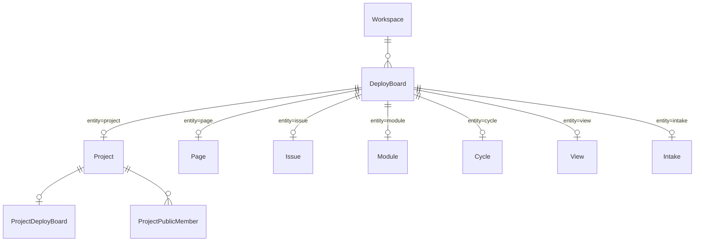

# 06. Space 公开发布（数据模型与 API 规格草案）

> 依据：CE `db/models/deploy_board.py`（高）、`db/models/project.py`（ProjectDeployBoard/ProjectPublicMember，高）、CE space 前端与 app 路由（高）、53 号实测（页面发布免费/CE 页面无发布入口，中-高）、59 号（Dashboard 发布同域 sites.plane.so，中）、55 号（Intake 发布走通）。

## 1. 实体与字段

### 1.1 DeployBoard（发布板，CE 已有，官方同构概率高）

| 字段                                                          | 类型        | 约束/默认                                           | 说明                                 | 可信度 |
| ------------------------------------------------------------- | ----------- | --------------------------------------------------- | ------------------------------------ | ------ |
| id                                                            | UUID        | -                                                   | -                                    | 高     |
| workspace                                                     | FK          | -                                                   | -                                    | 高     |
| entity_identifier                                             | UUID        | -                                                   | 被发布实体 id                        | 高     |
| entity_name                                                   | varchar(30) | enum：`project/issue/module/cycle/page/view/intake` | 发布实体类型                         | 高     |
| anchor                                                        | char(255)   | uuid4().hex，unique，索引                           | 公开 URL 寻址键                      | 高     |
| is_comments_enabled / is_reactions_enabled / is_votes_enabled | boolean     | default False                                       | CE 发布弹窗 3 开关                   | 高     |
| is_activity_enabled                                           | boolean     | default True                                        | -                                    | 高     |
| is_disabled                                                   | boolean     | default False                                       | 取消发布语义                         | 高     |
| intake                                                        | FK→Intake   | SET_NULL                                            | intake 发布时挂队列                  | 高     |
| view_props                                                    | JSON        | -                                                   | 发布的布局选择（Views: List/Kanban） | 高     |

### 1.2 ProjectDeployBoard（项目级发布配置，CE 已有）

`project.py:350`——项目发布态（例如 `is_published` 语义）+ 观察者配置；与 Project 1:1。

### 1.3 ProjectPublicMember（公开成员展示，CE 已有）

`project.py:370`——公开站上展示的项目成员行（与 ProjectMember 关联）。

### 1.4 Business 版扩展（页面/仪表板/视图/模块/周期发布）

| 扩展          | 说明                                                                                                                                                                 | 可信度                       |
| ------------- | -------------------------------------------------------------------------------------------------------------------------------------------------------------------- | ---------------------------- |
| 页面发布      | 云端编辑器「发布」→ `sites.plane.so/pages/{anchor}`，免费、无付费墙、取消发布回路；CE DeployBoard 已支持 entity_name=page 但**前端无入口**（53 号行菜单 6 项无发布） | 高（CE 模型）/中（云端流程） |
| 仪表板发布    | `sites.plane.so/dashboards/{anchor}`（59 号）                                                                                                                        | 中                           |
| 视图发布      | 云端工作区级视图**无**发布入口；CE 模型支持 entity_name=view                                                                                                         | 中（两侧均未启用）           |
| 模块/周期发布 | DeployBoard 枚举支持（module/cycle），UI 未暴露                                                                                                                      | 中                           |
| 站点目录      | CE space 首页为占位页「Nice! Just one more step.」，无目录                                                                                                           | 高                           |

## 2. 关系图

## 3. 端点表

| 方法             | 路径                                                                                                | 入参                                                                 | 出参           | 说明                                         | 可信度              |
| ---------------- | --------------------------------------------------------------------------------------------------- | -------------------------------------------------------------------- | -------------- | -------------------------------------------- | ------------------- |
| GET/POST         | `/api/workspaces/{slug}/projects/{id}/project-deploy-boards/`（CE 已有，`app/urls/project.py:113`） | `{entity_name, entity_identifier?, intake?, is_comments_enabled...}` | DeployBoard    | 发布实体（POST=发布）                        | 高                  |
| GET/PATCH/DELETE | `.../project-deploy-boards/{pk}/`                                                                   | is_disabled 等                                                       | DeployBoard    | 取消发布/改配置                              | 高                  |
| GET              | 公开 `/api/public/deploy-boards/{anchor}/`（space 域公开 API）                                      | anchor                                                               | 只读投影       | 匿名                                         | 高                  |
| GET              | 公开 `.../deploy-boards/{anchor}/issues/` 等                                                        | 分页                                                                 | -              | 公开数据                                     | 高                  |
| POST             | `.../deploy-boards/{anchor}/votes/`、`/reactions/`、`/comments/`                                    | -                                                                    | -              | 公开互动（is_votes/reactions/comments 门控） | 高（CE space 已有） |
| 页面发布         | 复用 POST project-deploy-boards `{entity_name:"page"}`                                              | -                                                                    | `{anchor,url}` | **web 前端补发布入口即可**                   | 中（端点形态推断）  |
| 仪表板发布       | `.../dashboards/{id}/publish/`（见 04 号）                                                          | -                                                                    | anchor         | 同 anchor 机制                               | 中                  |

## 4. 与 CE 对照

| 对象                      | CE 现状                                                              | 结论                     |
| ------------------------- | -------------------------------------------------------------------- | ------------------------ |
| DeployBoard 模型          | **完整已在**（`deploy_board.py`，7 类实体枚举+anchor+3 开关）        | **复用**，无迁移         |
| 发布 API                  | `app/urls/project.py` 已有管理端点；space 公开 API 在 `plane/space/` | **复用**                 |
| 页面发布入口              | CE 前端无入口（53 号）；模型支持                                     | **补 UI**（S 级）        |
| 站点体验                  | CE space 首页占位、无目录、有 Powered by                             | 差异可接受（53 号 D-03） |
| 云端独立域 sites.plane.so | CE 单域 :3002                                                        | 架构选择项，可保持单域   |

## 5. 迁移与数据兼容

1. **无新表**。官方升级风险点：DeployBoard `entity_name` 枚举官方可能新增（如 dashboard）——枚举为 CharField 无 choices 硬约束（CE 定义了 TYPE_CHOICES 仅应用层），无需 DB 迁移。
2. anchor 生成逻辑（uuid4().hex）保持；公开 URL 若与官方不同域不影响数据。
3. `0125_reset_project_deploy_board_identity.py` 是 CE 近期对发布身份的重置迁移——升级官方时注意 deploy_board 数据幂等。

## 6. SDK 有但 UI 未见字段

SDK 无 deploy board/publish 资源（407 ops 无）——同 04 号：发布面走 web 内部 API。CE 侧 DeployBoard 的 `is_activity_enabled`（默认 True）在云端发布弹窗中未见对应开关，UI 未见字段即此。

## 7. 依据与可信度汇总

高：CE 模型/路由/space API 全部。中：云端页面发布流程、dashboard 发布。低：视图/模块/周期发布的 UI 形态。
