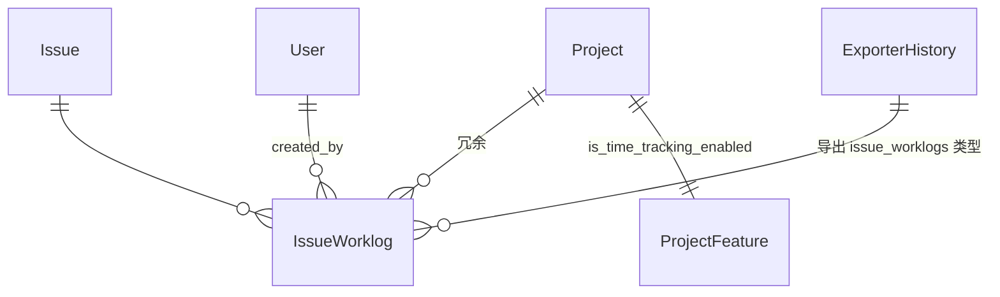

# 07. 时间跟踪工作日志（数据模型与 API 规格草案）

> 依据：UI 56 号实测（记录弹窗/工时表/导出/活动文案，中-高）；SDK v2 `worklogs` op 与 `models/v2/worklogs_summary.py`、资源路径 `/workspaces/{slug}/projects/{project_id}/work-items/{work_item_id}/worklogs/`（高）；CE 残留证据（exporter 枚举 `issue_worklogs`、`Project.is_time_tracking_enabled`，高）。

## 1. 实体与字段

### 1.1 IssueWorklog（工作日志条目）

| 字段                          | 类型     | 约束/默认                                                    | 说明                       | 可信度                                |
| ----------------------------- | -------- | ------------------------------------------------------------ | -------------------------- | ------------------------------------- |
| id                            | UUID     | -                                                            | -                          | 高（结构）                            |
| issue                         | FK→Issue | CASCADE                                                      | 工作项                     | 高                                    |
| project / workspace           | FK       | 冗余落列（v2 项目级汇总路径需要）                            |                            | 中                                    |
| duration                      | integer  | 秒；UI 拆小时+分钟输入（小时步进器/分钟 0-59），至少一项非 0 | 时长                       | 高（语义）/中（单位秒为行业惯例推断） |
| recorded_at                   | date     | 必填，默认今天；允许历史日期（实测 2026-11-13 补录）         | 记录日期                   | 中（字段名猜测）                      |
| description                   | text     | 选填                                                         | UI 描述框                  | 高                                    |
| created_by（=记录人）         | FK       | -                                                            | 工时表「记录」列=成员+日期 | 高                                    |
| external_id / external_source | varchar  | -                                                            | v2 op 惯例                 | 中                                    |
| created_at / updated_at       | -        | -                                                            | -                          | 高                                    |

命名候选：官方 v2 op id 为 `worklogs_*`；MCP 工具名 `work_log`。表名建议 `issue_worklogs`（与 exporter 枚举 `issue_worklogs` 一致——这是 CE 分叉点已留痕的官方命名证据）。

### 1.2 聚合与门控（虚拟面）

- Tracked time 汇总：`sum(duration) group by issue`（详情属性面板实时）。
- 项目工时表：`group by (project, work_item, recorded_by, recorded_at)` + Users/日期范围筛选（56 号 4.2 列结构）。
- v2 汇总端点返回裸数组 `{work_item_id, duration}`（WorklogSummaryEntry，两字段必填，高可信）。
- 计费门控：套餐文案 Free=无 / One=Basic / Pro=Historical timesheets（CE `plans.tsx:183`）；mcp-server `plan_gated` 对 work_log 标注 402。

## 2. 关系图

## 3. 端点表（v2 op 高可信，CE 无）

| 方法             | 路径                                                          | op                                       | 说明                                                                 | flag                        | 可信度                         |
| ---------------- | ------------------------------------------------------------- | ---------------------------------------- | -------------------------------------------------------------------- | --------------------------- | ------------------------------ |
| GET              | `/workspaces/{slug}/projects/{id}/work-items/{wid}/worklogs/` | worklogs_list                            | 条目列表（工作日志 tab 数据源）                                      | `is_time_tracking_enabled`  | 高                             |
| POST             | 同上                                                          | worklogs_create                          | `{duration, recorded_at?, description?}`                             |                             | 高                             |
| GET/PATCH/DELETE | `.../worklogs/{id}/`                                          | worklogs_retrieve/partial_update/destroy | 编辑就地更新（活动流不留编辑痕，实测）                               |                             | 高                             |
| GET              | `/workspaces/{slug}/projects/{id}/worklogs/summary/`          | project_worklogs_summary                 | 裸数组 `[{work_item_id, duration}]`；**非分页集合**                  |                             | 高                             |
| POST             | 导出（v1 exporter 管道）                                      | -                                        | `{type:"issue_worklogs", filters:{users?, date_range?}}` → Excel/CSV |                             | 高（枚举在 CE exporter.py:31） |
| GET              | 项目工时表聚合（56 号 4.2 四列表）                            | -                                        | group by work_item+记录                                              | 追赶自建或复用 summary+过滤 | 中                             |

权限：项目成员；编辑/删除权限边界未实测（56 号待验证 4）——建议记录人本人+Admin 可写。

## 4. 与 CE 对照

| 对象         | CE 现状                                                                                                                | 结论                                                                                                                                          |
| ------------ | ---------------------------------------------------------------------------------------------------------------------- | --------------------------------------------------------------------------------------------------------------------------------------------- |
| Worklog 模型 | **无**（`db/models/` 无 worklog 文件；`app/`、`api/views/` grep 零命中）                                               | **新建**                                                                                                                                      |
| 功能开关字段 | `Project.is_time_tracking_enabled`（`project.py:100`）+ serializer 暴露（`api/serializers/project.py:94`），无 UI 消费 | **复用**，接进功能设置页（S 级）                                                                                                              |
| 导出枚举     | `exporter.py:31` 已含 `("issue_worklogs", "Issue Worklogs")`（迁移 0070 同批加入）                                     | **复用** exporter 管道点亮枚举                                                                                                                |
| 活动流       | CE IssueActivity 有 actor 机制                                                                                         | 新增「记录了 2h 30m / 为 2026-11-13 记录了 1h」verb 渲染（实测文案）；增删改**不留 activity**（56 号实测），即 worklog 操作不写 IssueActivity |
| 工时表/导出  | 无                                                                                                                     | 新建聚合查询+导出                                                                                                                             |

## 5. 迁移与数据兼容

1. 新表 `issue_worklogs`：建议列（duration integer、recorded*at date、description text、issue/project/workspace FK、external*\*、审计列），无破坏性操作。
2. 升级官方冲突预案：官方 v2 已有 worklogs API，表名大概率 `issue_worklogs`（exporter 枚举旁证）→ 冲突概率低；若官方列名不同（如 `recorded_date`），RenameModel/RenameField 收敛。
3. 工作项删除级联：worklog 随 issue CASCADE（与「从报表和导出中移除」文案一致）。
4. 时区：recorded_at 为 date（无时区），与 CE IntakeIssue 的项目时区归整模式一致。

## 6. SDK 有但 UI 未见字段

| 字段                                                                                                                | 出处                                        | 可信度          |
| ------------------------------------------------------------------------------------------------------------------- | ------------------------------------------- | --------------- |
| 汇总端点非分页、裸数组形态（无 id/count/next）                                                                      | v2/worklogs_summary.py + worklogs.py 资源类 | 高              |
| WorklogSummaryEntry 无 external_id/audit 列（区别于其它 v2 实体的极简形态）                                         | 同上                                        | 高              |
| worklogs op 仅有 list/create/retrieve/partial_update/destroy 五件套，**无 bulk**（对照 cycles_bulk 等）             | constants.py                                | 高              |
| 项目级 worklogs（不挂单工作项的通用工时？）——v2 路径仅在 work-item 下 + summary，无 `/projects/{id}/worklogs/` CRUD | 资源 path 全表                              | 高（无此 CRUD） |

## 7. 依据与可信度汇总

高：v2 op/路径/汇总模型、CE 开关与 exporter 枚举、MCP 402 门控。中：IssueWorklog 精确字段（SDK 未给模型，UI+命名推断）、秒为单位。低：权限边界、项目级通用工时。
