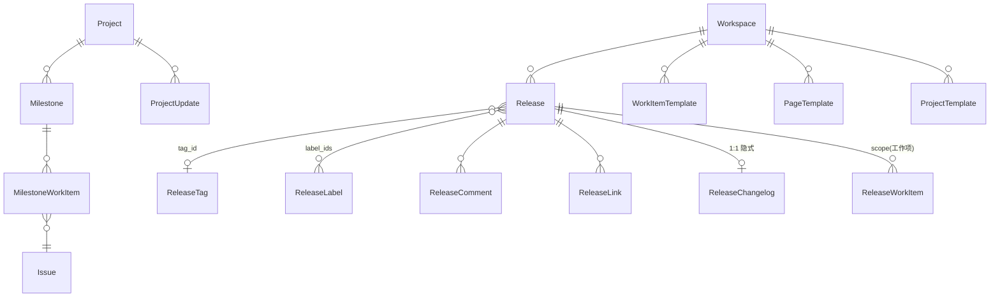

# 08. Releases 与 Milestones 与 Updates 与 Templates（数据模型与 API 规格草案）

> 依据：SDK `models/releases.py`、`models/v2/releases.py`、`models/milestones.py`、`models/v2/milestones.py`、`models/v2/milestone_work_items.py`、`models/workspace_templates.py`、`models/project_templates.py`、`models/v2/work_item_templates.py`（高）；UI 60 号实测（中-高）；CE 代码与迁移考古（高）。

## 1. 实体与字段

### 1.1 Release（发布，workspace 级，Business）

| 字段                          | 类型             | 约束/枚举                                                                                                              | 说明                                                   | 可信度 |
| ----------------------------- | ---------------- | ---------------------------------------------------------------------------------------------------------------------- | ------------------------------------------------------ | ------ |
| id                            | UUID             | -                                                                                                                      | -                                                      | 高     |
| workspace                     | FK               | -                                                                                                                      | 工作区级资源（v2 路径 `/workspaces/{slug}/releases/`） | 高     |
| name                          | varchar          | 必填，**全工作区唯一**（UI 创建弹窗注记）                                                                              | -                                                      | 高     |
| status                        | enum             | `unreleased(默认) / released / cancelled`                                                                              | 状态机                                                 | 高     |
| description                   | 富文本           | `description_html` 写、读回嵌套 `{description_html, description_json, description_id}`（v2 以独立 description 行存储） | 高                                                     | 高     |
| target_date / release_date    | date             | 可空                                                                                                                   | 立即发布弹窗选「发布日期」                             | 高     |
| lead_id                       | FK→User          | 可空                                                                                                                   | 负责人                                                 | 高     |
| tag_id                        | FK→ReleaseTag    | 单个                                                                                                                   | 版本 tag                                               | 高     |
| label_ids                     | M2M→ReleaseLabel | 多个                                                                                                                   | 发版标签                                               | 高     |
| is_latest / is_prerelease     | boolean          | -                                                                                                                      | -                                                      | 高     |
| external_id / external_source | varchar          | -                                                                                                                      | -                                                      | 高     |
| start_date / logo_props       | -                | **已废弃**（SDK 标注 deprecated/ignored）                                                                              | 不实现                                                 | 高     |

### 1.2 ReleaseTag（版本 tag 目录，workspace 级）

`{id, version(唯一), description?, git_tag?, commit_hash?}`；详情路由支持 `version:<value>` 前缀查找；**不是 label**（无 name/color/sort_order——SDK 显式标注 deprecated 字段）。

### 1.3 ReleaseLabel（发版标签目录，workspace 级）

`{id, name, color?, sort_order?}`——独立于工作项标签。

### 1.4 ReleaseComment / ReleaseLink / ReleaseChangelog（发布子资源）

- Comment：`{release, comment(嵌套 {description_html}), comment_html 写, is_hidden, is_resolved, parent, edited_at}`。
- Link：`{release, title, url, metadata(JSON)}`。
- Changelog：**与 Release 1:1，随发布隐式创建，无 create/delete**，只有 retrieve/update（`{description_html, description_json}`）——UI「更新日志」tab 富文本自动保存。

### 1.5 Milestone（里程碑，project 级，预热中）

| 字段                          | 类型     | 约束                                                      | 说明            | 可信度 |
| ----------------------------- | -------- | --------------------------------------------------------- | --------------- | ------ |
| id                            | UUID     | -                                                         | -               | 高     |
| project                       | FK       | -                                                         | v2 路径项目级   | 高     |
| title                         | varchar  | **必填**（识别字段；list 过滤参数为 `?name=` 服务端别名） | -               | 高     |
| target_date                   | date     | 可空                                                      | UI 日历         | 高     |
| archived_at                   | datetime | 可空                                                      | v2 读模型有归档 | 高     |
| external_id / external_source | varchar  | -                                                         | -               | 高     |
| 进度                          | 虚拟     | 创建后 0%；=关联工作项完成率                              | UI 实证         | 中     |

**迁移考古**：本仓库 `git log --all -S "class Milestone"`、`-i --grep milestone` 均零命中——CE 历史从未有过 Milestone 模型/迁移（60 号「连开关字段都没有」一致）。Milestone 是 EE 新表。

### 1.6 ProjectUpdate（项目更新，project 级）

| 字段              | 类型                                    | 约束/枚举                                                                           | 说明     | 可信度 |
| ----------------- | --------------------------------------- | ----------------------------------------------------------------------------------- | -------- | ------ |
| id                | UUID                                    | -                                                                                   | -        | 中     |
| project           | FK                                      | -                                                                                   | -        | 中     |
| progress          | enum                                    | `ON_TRACK(进展顺利) / AT_RISK(有风险) / OFF_TRACK(偏离轨道)`（UI 三态；枚举值猜测） | 进度标记 | 中     |
| content           | text                                    | 必填（placeholder「添加更新」）                                                     | -        | 中     |
| progress_snapshot | JSON                                    | 发布时刻快照「已完成 2/4，进度 50%」                                                | 系统生成 | 中     |
| 评论/反应         | 复用 Comment/Reaction 机制（UI 卡片内） |                                                                                     | 低       |

### 1.7 Template 三件套（workspace 级）

| 实体             | 字段                                                                                                                       | 可信度                                                    |
| ---------------- | -------------------------------------------------------------------------------------------------------------------------- | --------------------------------------------------------- |
| WorkItemTemplate | `{id, name, description, description_html, template_data(JSON：标题/类型/状态/负责人/标签/子工作项/项目绑定), logo_props}` | 高（SDK workspace_templates.py + v2 work_item_templates） |
| PageTemplate     | 同构，template_data 含页面标题+正文                                                                                        | 高                                                        |
| ProjectTemplate  | `{id, name, description, template_data(JSON：项目名/封面/network/lead/7 功能开关/状态 5 项/标签/类型/启动工作项)}`         | 高                                                        |

模板无 project FK（workspace 级目录），项目绑定在 template_data 内（v2 有项目级路径 `/projects/{id}/work-item-templates/`）。

## 2. 关系图

## 3. 端点表（v2 op 高可信）

| 方法                  | 路径                                               | op                                         | 说明                                     | flag                                   | 可信度                           |
| --------------------- | -------------------------------------------------- | ------------------------------------------ | ---------------------------------------- | -------------------------------------- | -------------------------------- |
| GET/POST              | `/workspaces/{slug}/releases/`                     | releases_list/create                       | 未发布/已发布 tab=`?status=`             | workspace+project `is_release_enabled` | 高                               |
| GET/PATCH/DELETE      | `.../releases/{id}/`                               | -                                          | -                                        |                                        | 高                               |
| GET/POST              | `.../releases/{id}/work-items/`                    | releases_work_items                        | `{add:[],remove:[]}` → `{added,removed}` |                                        | 高                               |
| GET/POST/PATCH/DELETE | `.../releases/{id}/comments/`、`/links/`           | release_comments/links                     |                                          |                                        | 高                               |
| GET/PATCH             | `.../releases/{id}/changelog/`                     | releases_changelog                         | 无 create/delete                         |                                        | 高                               |
| GET/POST/PATCH/DELETE | `.../releases/labels/`、`.../releases/tags/`       | release_labels/tags                        | 目录；tag 详情支持 `version:` 前缀       |                                        | 高                               |
| POST                  | `.../releases/{id}/labels/`（add/remove bridge）   | releases_labels                            |                                          |                                        | 高                               |
| 发布动作              | release `status→released`（`is_latest` 翻转）      | -                                          | UI「立即发布」                           |                                        | 中（无独立 op，走 PATCH status） |
| GET/POST              | `.../projects/{id}/milestones/`                    | milestones_list/create                     | `?name=` 过滤                            | `is_milestone_enabled`                 | 高                               |
| GET/PATCH/DELETE      | `.../milestones/{id}/`                             | -                                          |                                          |                                        | 高                               |
| POST                  | `.../milestones/{id}/work-items/`                  | milestones_work_items                      | `{add,remove}` → `{added,removed}`       |                                        | 高                               |
| 同构                  | `.../milestones/` bulk                             | milestones_bulk                            |                                          |                                        | 高                               |
| -                     | ProjectUpdate                                      | **v2 无 op**（407 ops 无 project_updates） | UI 独有（概览右栏 tab）；追赶自建 CRUD   | `is_project_updates_enabled`           | 高（缺失证据）/中（字段）        |
| GET/POST              | `/workspaces/{slug}/work-item-templates/` 及项目级 | workspace/project_work_item_templates      |                                          | 无 flag（Business 直用）               | 高                               |
| 同构                  | 页面模板（pages? template 参数）与项目模板         | -                                          | SDK workspace_templates 走 v1 面         |                                        | 高/中                            |

## 4. 与 CE 对照

| 对象          | CE 现状                                                                                    | 结论                                                                                                                |
| ------------- | ------------------------------------------------------------------------------------------ | ------------------------------------------------------------------------------------------------------------------- |
| Release 族    | 无（grep `release` 仅事务注释）                                                            | **新建**：releases/release_tags/release_labels/release_comments/release_links/release_changelogs + release↔issue 桥 |
| Milestone     | 无（git 考古零命中）                                                                       | **新建**：`milestones` + `milestone_issues` 桥（或 issue.milestone FK——v2 bridge 语义建议桥表）                     |
| ProjectUpdate | 无（无模型无开关字段）                                                                     | **新建**：`project_updates` + `Project.is_project_updates_enabled`                                                  |
| Templates     | 后端无模型；**仅残留完整中文文案包** `packages/i18n/src/locales/*/template.json`（无引用） | **新建**：`work_item_templates/page_templates/project_templates`（template_data JSON）；文案包可直接接线            |
| 功能开关      | CE `Project` 仅 is_time_tracking/is_issue_type 两个                                        | 新建开关统一方案见 10 号                                                                                            |
| 状态机        | CE 无 release 状态机                                                                       | unreleased→released/cancelled；is_latest 全局唯一翻转                                                               |

## 5. 迁移与数据兼容

1. 新表命名：`releases`（注意与 issue.py 注释无关，无冲突）、`release_tags`、`release_labels`、`milestones`、`project_updates`、`*_templates`。
2. **官方升级 schema 冲突预案**：
   - Release 的富文本：v2 读模型带 `description_id`（独立 Description 行存储）——CE 已有 `Description/DescriptionVersion`（`db/models/description.py`），直接复用，避免自建文本列（对齐官方存储）。
   - Milestone↔Issue 关系：v2 用 bridge（add/remove）语义，追赶用桥表 `milestone_issues` 而非 Issue 上加 FK，官方升级时 RenameModel 即可。
   - ProjectUpdate 官方结构未知（低可信），其 progress_snapshot 用 JSONField 保持弹性。
3. Templates 的 template_data 全 JSON，官方演进无需迁移；模板应用=预填表单（工作项）/复制内容（页面/项目），落库在既有实体，无兼容风险。
4. `is_milestone_enabled` 开关与 CE `data-testid` 命名规范一致（60 号实测），直接加列。

## 6. SDK 有但 UI 未见字段

| 字段                                                              | 出处                       | 可信度     |
| ----------------------------------------------------------------- | -------------------------- | ---------- |
| Release `is_latest`、`is_prerelease`（UI 创建弹窗未见）           | v2/releases.py             | 高         |
| ReleaseTag 的 `commit_hash/git_tag`（git 集成语义，UI 未见）      | v2/releases.py             | 高         |
| Release Comment `is_hidden`（隐藏评论）                           | releases.py                | 高         |
| Release 的 external_id/external_source（upsert 语义未见 UI）      | v2/releases.py             | 高         |
| Milestone `archived_at`（UI 无归档入口）                          | v2/milestones.py           | 高         |
| MilestoneWorkItem 管理的幂等语义（already linked 不出现在 added） | v2/milestone_work_items.py | 高         |
| v1 Release `start_date/logo_props` deprecated 字段                | models/releases.py         | 高（废弃） |
| ProjectUpdate 进度快照聚合口径（完成÷总数？取消是否剔除）         | 60 号 UI                   | 低         |

## 7. 依据与可信度汇总

高：Release/Milestone/Template 全字段与 op（SDK）；CE 缺失与迁移考古。中：ProjectUpdate 实体、发布动作端点、进度口径。低：ProjectUpdate 枚举值与快照结构。
