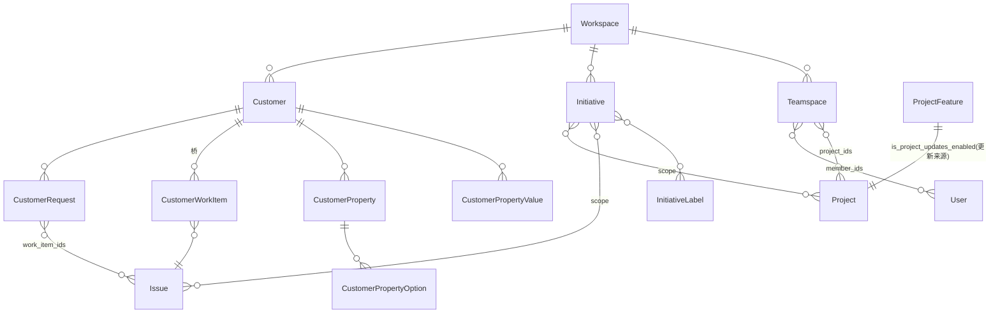

# 09. Customers 与 Initiatives 与 Teamspaces（数据模型与 API 规格草案）

> 依据：SDK `models/customers.py`、`models/v2/customers.py`、`models/v2/customer_properties.py`、`models/initiatives.py`、`models/v2/initiatives.py`、`models/teamspaces.py`、`models/v2/teamspaces.py`（高）；UI 60/61 号实测（中-高）；CE 代码（高）。

## 1. 实体与字段

### 1.1 Customer（客户档案，workspace 级，Business）

| 字段                               | 类型     | 约束/默认                                                                                   | 说明                          | 可信度 |
| ---------------------------------- | -------- | ------------------------------------------------------------------------------------------- | ----------------------------- | ------ |
| id                                 | UUID     | -                                                                                           | -                             | 高     |
| workspace                          | FK       | -                                                                                           | -                             | 高     |
| name                               | varchar  | 必填；create=**upsert**：external_id+source 命中→更新，否则同名→更新，否则新建              | UI「客户名称」                | 高     |
| description                        | 富文本   | description_html/description_stripped/description_binary                                    | -                             | 高     |
| email / website_url / domain       | varchar  | 可空                                                                                        | website 校验「https:// 开头」 | 高     |
| employees                          | integer  | 可空                                                                                        | UI「规模」                    | 高     |
| industry                           | varchar  | 可空（UI「行业」，SDK 模型未见独立列→可能落 domain 或 v1 模型 extra；以 UI 为准实现独立列） |                               | 中     |
| stage                              | varchar  | 受控枚举（UI 下拉：合同谈判…；枚举值全集未录）                                              | -                             | 中     |
| contract_status                    | varchar  | 受控枚举（带状态圆点；已签署…）                                                             | -                             | 中     |
| revenue                            | varchar  | 可空                                                                                        | -                             | 高     |
| logo_asset / logo_props / logo_url | -        | 头像                                                                                        | 高                            |
| customer_request_count             | int      | 聚合读字段                                                                                  | 高                            |
| archived_at                        | datetime | 可空                                                                                        | -                             | 高     |
| external_id / external_source      | varchar  | -                                                                                           | -                             | 高     |

### 1.2 CustomerProperty / Option / Value（客户自定义属性）

- Property：与工作项属性同构（`display_name 必填, property_type: TEXT/DATETIME/DECIMAL/BOOLEAN/OPTION/RELATION/URL/EMAIL/FILE（**无 FORMULA/CASCADING**）, relation_type: ISSUE/USER, is_active/is_multi/is_required, default_value[], settings, options[]`）。
- Value：bulk upsert `{values: {property_id: [str]}}`——**所有值一律字符串**（RootModel dict[str, list[str]]）；未提到的属性不动。
- 管理 UI 在工作区设置→客户→属性（60 号待验证 1，未展开）。

### 1.3 CustomerRequest（客户请求）

`{id, customer, name 必填, description(富文本), link?, work_item_ids[]（write-only，创建时挂）, archived_at, attachment_count(读)}`——UI「请求｜关联工作项」双 tab；工作项侧反查（Customers 字段）。

### 1.4 CustomerWorkItem 桥

`{customer, work_item}` M2M；bridge `{add, remove}` → `{added, removed}`；读侧返回 `{id, name, state_id, priority, sequence_id, project_id, project__identifier}`。

### 1.5 Initiative（计划，workspace 级）

| 字段                        | 类型                | 约束/枚举                                                                    | 说明                       | 可信度 |
| --------------------------- | ------------------- | ---------------------------------------------------------------------------- | -------------------------- | ------ |
| id                          | UUID                | -                                                                            | -                          | 高     |
| workspace                   | FK                  | -                                                                            | -                          | 高     |
| name                        | varchar(255)        | 必填（UI 标题旁字符计数 X/255）                                              | -                          | 高     |
| description                 | 富文本              | description_html/stripped/binary                                             | -                          | 高     |
| state                       | enum                | `DRAFT(默认 Drafts) / PLANNED / ACTIVE / COMPLETED / CLOSED`                 | UI 默认 Drafts             | 高     |
| start_date / end_date       | datetime            | end≥start（服务端校验）                                                      | 日期范围                   | 高     |
| lead_id                     | FK                  | 可空                                                                         | 负责人                     | 高     |
| project_ids / work_item_ids | M2M bridge          | `{add,remove}`                                                               | Scope（项目/工作项两 tab） | 高     |
| label_ids                   | M2M→InitiativeLabel | workspace 级标签目录 `{name,color,description,sort_order}`；启用前标签区锁定 | 高                         |
| logo_props / archived_at    | -                   | emoji+颜色                                                                   | 高                         |

进度环/状态组分布条/At risk 指示：聚合字段（读时计算自关联项目/工作项），无独立列（中）。

### 1.6 Teamspace（团队空间，workspace 级）

| 字段             | 类型    | 说明                                                                                   | 可信度 |
| ---------------- | ------- | -------------------------------------------------------------------------------------- | ------ |
| id               | UUID    | -                                                                                      | 高     |
| workspace        | FK      | -                                                                                      | 高     |
| name             | varchar | 必填（「Name this teamspace.」）                                                       | 高     |
| description_html | text    | -                                                                                      | 高     |
| lead_id          | FK      | 团队负责人                                                                             | 高     |
| member_ids       | M2M     | 团队成员                                                                               | 高     |
| project_ids      | M2M     | 关联项目→成员获项目访问（「Grant the teamspace access to the selected projects」文案） | 高     |
| logo_props       | JSON    | emoji                                                                                  | 高     |

子资源：teamspaces 下 views/pages（61 号：团队视图不干扰工作区视图；团队页面 Public/Archived）——v2 无独立 op（407 ops 仅 teamspaces CRUD），推断复用 workspace views/pages + teamspace 过滤（低）。

## 2. 关系图

## 3. 端点表（v2 op 高可信）

| 方法                      | 路径                                                              | op                                                                      | flag                              | 可信度 |
| ------------------------- | ----------------------------------------------------------------- | ----------------------------------------------------------------------- | --------------------------------- | ------ |
| GET/POST/GET/PATCH/DELETE | `/workspaces/{slug}/customers/`、`/{id}/`                         | customers\_\*（含 `customers_upsert`）                                  | workspace `is_customer_enabled`   | 高     |
| GET/POST/…                | `.../customers/{id}/requests/`                                    | customer*requests*\*                                                    |                                   | 高     |
| GET/POST                  | `.../customers/{id}/work-items/`                                  | customers_work_items（bridge）                                          |                                   | 高     |
| GET/POST/…                | `.../customer-properties/`                                        | customer*properties*\*                                                  |                                   | 高     |
| GET/POST                  | `.../customers/{id}/property-values/`                             | customer_property_values_list/create（bulk upsert）                     |                                   | 高     |
| GET/POST                  | `/workspaces/{slug}/initiatives/`                                 | initiatives\_\*                                                         | workspace `is_initiative_enabled` | 高     |
| GET/POST/…                | `.../initiatives/labels/`、`/{id}/projects/`、`/{id}/work-items/` | initiative_labels/initiatives_projects/initiatives_work_items（bridge） |                                   | 高     |
| GET/POST                  | `/workspaces/{slug}/teamspaces/`                                  | teamspaces\_\*                                                          | workspace `is_teams_enabled`      | 高     |
| GET/PATCH/DELETE          | `.../teamspaces/{id}/`                                            |                                                                         |                                   | 高     |

权限：Customers/Initiatives/Teamspaces 均 Guest 不可见（60 号官方口径）。ProjectUpdate 的 v2 缺失同 08 号。

## 4. 与 CE 对照

| 对象                    | CE 现状                                   | 结论                                                                                                 |
| ----------------------- | ----------------------------------------- | ---------------------------------------------------------------------------------------------------- |
| Customer 族             | 完全无（grep 零命中）                     | **新建**：customers/customer_requests/customer_properties/customer_property_values/customer↔issue 桥 |
| Initiative              | 完全无                                    | **新建**：initiatives/initiative_labels + 两桥                                                       |
| Teamspace               | 完全无                                    | **新建**：teamspaces/teamspaces_members/teamspaces_projects                                          |
| 工作项侧 Customers 字段 | 无                                        | Issue 属性面板反查（经桥表，无 Issue 列变更）                                                        |
| 进度聚合                | CE analytics 已有状态组聚合查询           | Initiative 进度环复用                                                                                |
| Teamspace 访问管道      | CE WorkspaceMember/ProjectMember 双层角色 | Teamspace 桥→自动建 ProjectMember（Contributor 级，61 号 D-03 XL）                                   |

## 5. 迁移与数据兼容

1. 新表 7-9 张；Customer 的 stage/contract_status 用 CharField+应用层枚举（官方枚举值不可考，避免 choices 锁死）。
2. CustomerProperty 值全字符串化对齐 SDK（`dict[str, list[str]]`）——实现 EAV 时统一 str 转换层。
3. **upsert 语义**：customers_create 带 external_id/source 时按官方三段规则（external→name→insert）实现，便于外部同步并升。
4. Teamspace 开启官方称「单向不可关」——追赶实现 flag 时允许关闭但数据保留（低风险偏离，标注）。
5. 升级冲突：Customer.industry 为 UI 推断列，官方若落 domain/props JSON，改列收敛；其余字段名与 SDK 完全一致，冲突面小。

## 6. SDK 有但 UI 未见字段

| 字段                                                                                       | 出处                      | 可信度 |
| ------------------------------------------------------------------------------------------ | ------------------------- | ------ |
| Customer `domain`（与 website 并列）                                                       | v2/customers.py           | 高     |
| Customer `archived_at`（UI 无归档入口）                                                    | v2/customers.py           | 高     |
| CustomerProperty relation_type `USER`（属性关联成员）                                      | v2/customer_properties.py | 高     |
| Initiative `label_ids` 的独立 workspace 标签目录                                           | v2/initiatives.py         | 高     |
| Teamspace `member_ids/project_ids` 内联于读写模型（无需逐成员端点）                        | v2/teamspaces.py          | 高     |
| Initiative description 的 `description_binary`（v1 模型）                                  | models/initiatives.py     | 高     |
| CustomerRequest `attachment_count`（读侧聚合）                                             | models/customers.py       | 高     |
| CollectionMember source=`group_sync`（IdP 组自动授权集合，属 11 号 Wiki 域，此处关联提示） | v2/collections.py         | 高     |

## 7. 依据与可信度汇总

高：Customers/Initiatives/Teamspaces 全字段与 op（SDK 与 UI 60/61 高度互证）。中：stage/contract_status/industry 枚举与列归属、进度聚合口径。低：Teamspace 子资源（views/pages）的 v2 形态。
