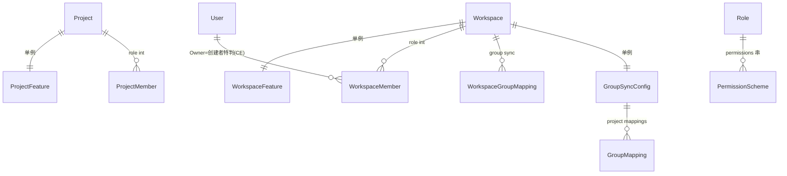

# 10. 权限角色与 FeatureToggle（数据模型与 API 规格草案）

> 依据：SDK `models/v2/features.py`（18 toggle 全模型，高）、`models/v2/roles.py`、`permissions.py`、`permission_schemes.py`、`models/roles.py`、`models/v2/group_sync.py`（高）；UI 51 号（4 级角色/Billing Status/治理页，中-高）；CE 代码（高）。

## 1. 实体与字段

### 1.1 WorkspaceFeature（工作区功能开关单例，无独立行 id 承载在 workspace）

| 字段（全部 boolean）               | 对应域             | 可信度 |
| ---------------------------------- | ------------------ | ------ |
| is_customer_enabled                | 09 号 Customers    | 高     |
| is_initiative_enabled              | 09 号 Initiatives  | 高     |
| is_member_project_creation_enabled | 成员可否建项目     | 高     |
| is_pi_enabled                      | Plane Intelligence | 高     |
| is_project_grouping_enabled        | 项目分组           | 高     |
| is_release_enabled                 | 08 号 Releases     | 高     |
| is_state_duration_enabled          | 状态时长           | 高     |
| is_teams_enabled                   | 09 号 Teamspaces   | 高     |
| is_wiki_enabled                    | 11 号 Wiki         | 高     |
| is_work_item_types_enabled         | 01 号              | 高     |
| is_workitem_hierarchy_enabled      | 02 号              | 高     |
| work_item_type_default_level       | int                | 高     |

### 1.2 ProjectFeature（项目级单例，无 id 字段）

| 字段                                 | 对应域       | 可信度 |
| ------------------------------------ | ------------ | ------ |
| is_automated_cycle_enabled           | 自动周期     | 高     |
| is_epic_enabled                      | 02 号        | 高     |
| is_manually_start_end_cycles_enabled | 手动起止周期 | 高     |
| is_milestone_enabled                 | 08 号        | 高     |
| is_parallel_cycles_enabled           | 并行周期     | 高     |
| is_project_updates_enabled           | 08 号        | 高     |
| is_workflow_enabled                  | 03 号        | 高     |

（CE 已有对应 UI 开关的字段：is_time_tracking_enabled、is_issue_type_enabled——**不在 v2 ProjectFeature 模型中**，说明官方时间跟踪/类型开关走项目 model 字段而非 feature 单例，追赶保持同构。）

### 1.3 Role（角色定义，只读）

`{id, name, slug, description, level:int, namespace: instance|workspace|project, status: active|inactive, is_system}`；slug 非全局唯一（admin/guest 在 workspace/project 双命名空间重复）。云端 UI 4 级：Owner/Admin/Member/Guest（51 号）。

### 1.4 PermissionScheme（权限方案，只读）

`{id, name, slug, description, namespace, permissions: list[str], is_system, sort_order}`——"v1 external parity" 注释表明它对齐 v1 的外部分级（CE 的 20/15/5 整型角色）。

### 1.5 EffectivePermissions（有效权限，读侧）

`GET .../permissions/me/` → `{relation, permission_grants: list[str]}`——调用主体的授权串列表（workspace 与 project 两级路径）。

### 1.6 Governance（工作空间治理，Enterprise，配置集中化）

UI：设置页 + 「启用治理」永久开关 + 升级门控；语义=工作区级集中管理状态/工作流/自动化/模板，项目只读引用。SDK 无独立模型（走 workspace catalog 资源，见 workspace_workflows/workspace_project_states 等）；**模型面=各 catalog 资源 + project 侧只读消费**（低-中）。

### 1.7 GroupSync（IdP 组同步，Enterprise/SCIM 面）

- GroupSyncConfig（workspace 单例）：`{group_attribute_key, is_enabled, sync_on_login, sync_offline, auto_remove, default_workspace_role_slug}`，仅 GET/PATCH。
- WorkspaceGroupMapping：`{idp_group_name, role_slug}`。
- GroupMapping（项目级）：`{idp_group_name, role_slug, project_id | all_projects}`。

### 1.8 云端成员页扩展（UI）

Billing Status 列（付费席位状态）、成员页双 tab（用户/智能体和应用）——Seat/Billing 实体未在 SDK 暴露（低）。

## 2. 关系图

## 3. 端点表

| 方法      | 路径                                                                      | op                                                | 说明                                 | 可信度 |
| --------- | ------------------------------------------------------------------------- | ------------------------------------------------- | ------------------------------------ | ------ |
| GET/PATCH | `/workspaces/{slug}/features/`                                            | workspace_features/workspace_features_update      | WorkspaceFeature 单例                | 高     |
| GET/PATCH | `.../projects/{id}/features/`                                             | project_features/project_features_update          | ProjectFeature 单例                  | 高     |
| GET       | `/workspaces/{slug}/roles/`                                               | roles_list/retrieve                               | 角色（namespace 过滤 `?namespace=`） | 高     |
| GET       | `/workspaces/{slug}/permission-schemes/`                                  | permission_schemes_list/retrieve                  | 只读                                 | 高     |
| GET       | `/workspaces/{slug}/permissions/me/`、`.../projects/{id}/permissions/me/` | workspaces_permissions_me/projects_permissions_me | 有效权限                             | 高     |
| GET       | `.../projects/{id}/role-distribution/`                                    | project_role_distribution                         | 项目角色分布                         | 高     |
| GET/PATCH | `.../group-sync/config/`                                                  | group_sync_config/group_sync_config_update        |                                      | 高     |
| CRUD      | `.../group-sync/workspace-mappings/`、`.../project-mappings/`             | group*sync_workspace/project_mappings*\*          |                                      | 高     |
| -         | Billing Status/席位                                                       | 无 v2 op                                          | 云端内部（账单域）                   | 低     |

权限要求：features PATCH=Admin+；roles/permission-schemes 读=Member+（推断，中）。

## 4. 与 CE 对照

| 对象                 | CE 现状                                                                                                                                                 | 结论                                                                                                                       |
| -------------------- | ------------------------------------------------------------------------------------------------------------------------------------------------------- | -------------------------------------------------------------------------------------------------------------------------- |
| 工作区角色           | `WorkspaceMember.role` 整型 20/15/5（`db/models/workspace.py:198`，Owner=创建者特判不落档）                                                             | **扩展**：加 Owner=25 档或引入 role 表；最小方案=保留整型、加 25 常量+邀请面（51 号 D-01 M）                               |
| 项目角色             | `ProjectMember.role` 20/15/5（`project.py:24`）                                                                                                         | 同上                                                                                                                       |
| Project feature 字段 | `Project` 已有 `is_time_tracking_enabled/is_issue_type_enabled/intake_view/module_view/cycle_view/issue_views_view/page_view` 等（`project.py:95-102`） | **复用**并补 7 个 v2 对齐字段（milestone/workflow/updates/epic/automated_cycle/parallel_cycles/manually_start_end_cycles） |
| Workspace feature    | 无单例                                                                                                                                                  | **新建** WorkspaceFeature 单例或 Workspace JSON；推荐**单列表**（官方为字段面明确的单例）                                  |
| Billing Status       | 无                                                                                                                                                      | 延后（商业化域）                                                                                                           |
| SAML/OIDC/SCIM       | 完全无                                                                                                                                                  | 延后（51 号 D-05 XL）；GroupSync 可作为独立域先行（模型独立于 SSO）                                                        |
| Governance           | 无                                                                                                                                                      | 延后（XL）                                                                                                                 |

## 5. 迁移与数据兼容

1. **开关注册表**：追赶建立统一的 feature registry（workspace 12 项 + project 9 项，含 CE 已有 2 项），DB 层=WorkspaceFeature 单表 + Project 补列；`data-testid` 保持 `project-feature-toggle-<field>` 官方命名（56/60 号实测）。
2. Owner 角色迁移：新建迁移把创建者 WorkspaceMember.role 置 25；角色比较工具函数（`plane/permissions/` 如有）逐点替换。
3. 升级官方冲突预案：官方 ProjectFeature 无 id 字段（模型级单例）——追赶若实现为 `project_features` 表，升级时把列迁回 Project 表即可；反之亦然。建议**直接放 Project 表**（官方语义），零冲突。
4. GroupSync 与 CE 无 SCIM 基础：可先落模型与手动 API（无 IdP 对接），升级官方时冲突小。

## 6. SDK 有但 UI 未见字段

| 字段                                                                                                                            | 出处                     | 可信度 |
| ------------------------------------------------------------------------------------------------------------------------------- | ------------------------ | ------ |
| `is_member_project_creation_enabled`（成员建项目开关，UI 未见）                                                                 | v2/features.py           | 高     |
| `is_pi_enabled`（Plane Intelligence 总开关）                                                                                    | v2/features.py           | 高     |
| `is_project_grouping_enabled`（项目分组）                                                                                       | v2/features.py           | 高     |
| `is_state_duration_enabled`（状态时长/SLA 面）                                                                                  | v2/features.py           | 高     |
| `is_automated_cycle_enabled / is_parallel_cycles_enabled / is_manually_start_end_cycles_enabled`（周期三开关，UI 创建弹窗未见） | v2/features.py           | 高     |
| `work_item_type_default_level`                                                                                                  | v2/features.py           | 高     |
| Role.namespace `instance`（实例级角色）                                                                                         | v2/roles.py              | 高     |
| `permission_schemes` 的 `sort_order` 与 `is_system`                                                                             | v2/permission_schemes.py | 高     |
| `EffectivePermissions.relation` 语义（授权关系串格式）                                                                          | v2/permissions.py        | 低     |
| GroupSync `sync_offline`（离线成员同步清理）                                                                                    | v2/group_sync.py         | 高     |

## 7. 依据与可信度汇总

高：18 toggle 全字段、roles/permission_schemes/group_sync 模型、CE 角色整型。中：4 级角色落地方式、端点权限档位。低：Billing/Seat、EffectivePermissions.relation 格式、Governance 内部模型。
