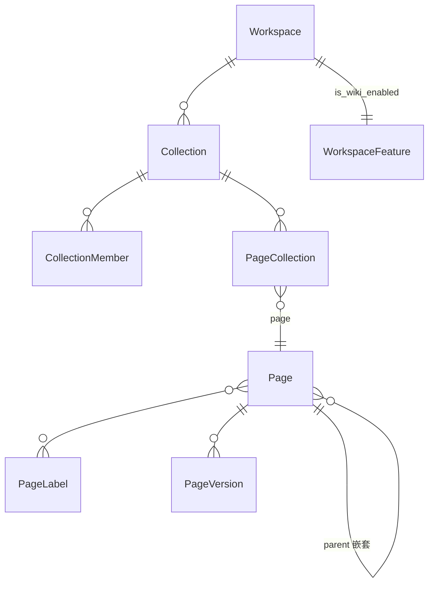

# 11. Wiki 集合与嵌套（P2 方案级）

> 依据：SDK `models/collections.py`、`models/v2/collections.py`、`models/pages.py`、`models/v2/pages.py`、v2 路径 `pages.py/collections/`（高）；UI 61 号（中）；CE `db/models/page.py`（高）。

## 实体

- **Collection**（集合，workspace 级）：`{id, name, access: 0 公开/1 私有, is_default, is_global, owned_by_id, sort_order, logo_props, page_ids[]}`。**access 创建后不可改**（UpdateCollection 无 access 字段，API 400）。
- **CollectionMember**：`{collection, member, access: 0 VIEW/1 COMMENT/2 EDIT, source: manual|group_sync}`；管理 bridge `{add:[{member_id, access?}], remove:[member_id]}` → `{added, removed}`。
- **Page（v2，workspace 级）**：CE Page 模型基础上显式暴露 `{collection_id, page_collection_id（成员行 id，移动集合时寻址）, parent_id, sort_order, is_global, access: 0/1}`；`CreatePage.collection_id` 缺省→自动挂公开默认集合（私有页须显式指定私有集合）。
- **PageCollection**（桥）：`{collection, page, sort_order, placement?}`——表格排序/嵌套放置。

## 端点（v2 op）

| 方法             | 路径                                          | op                                     |
| ---------------- | --------------------------------------------- | -------------------------------------- |
| GET/POST         | `/workspaces/{slug}/collections/`             | collections\_\*                        |
| GET/PATCH/DELETE | `.../collections/{id}/`                       |                                        |
| POST             | `.../collections/{id}/members/`               | collections_members（bridge）          |
| GET              | `.../collections/{id}/members/list/`          | collections_members_list               |
| POST             | `.../collections/{id}/pages/`                 | collections_pages（add/remove bridge） |
| GET              | `.../collections/{id}/pages/search/`          | collections_pages_search               |
| GET/POST         | `.../pages/`（project 级与 workspace 级两组） | project_pages / workspace_pages        |
| GET/PATCH/DELETE | `.../pages/{id}/`                             |                                        |

flag：workspace `is_wiki_enabled`。

## CE 对照与迁移

- CE **Page 已是 workspace 级**（`db/models/page.py:23`：workspace FK、access、parent 自 FK、is*global、ProjectPage M2M、PageLabel/PageVersion/PageLog、moved_to*\*）——**复用**，缺的是 Collection 两表 + 移动/排序端点 + Wiki 容器 UI。
- PageLabel 模型与 app serializer 已在（`page.py:120`、`app/serializers/page.py:93-114`）——**复用**，补管理页。
- 迁移：新建 `page_collections / collection_members`；Page 不动列（collection 归属走桥表，与 SDK page_collection_id 语义一致）。升级冲突小：官方 Collection 与页面同构概率高。

## SDK 有但 UI 未见

- `is_default/is_global` 集合标记（默认集合自动挂载语义）——高。
- CollectionMember.source=`group_sync`（IdP 组授权集合）——高。
- `placement`（页面在集合内的树形放置对象）——中。
- UpdateCollection 可改 `access`（v2 模型有 access 写字段，与 v1「改 access 400」相反）——中，疑似 golden 不一致。

## 可信度

高：Collection/Member/Page 全字段与 op。中：placement 结构、v1/v2 access 更新矛盾。低：Wiki 主页聚合端点（页面/最近/Sticky 组合页）。
