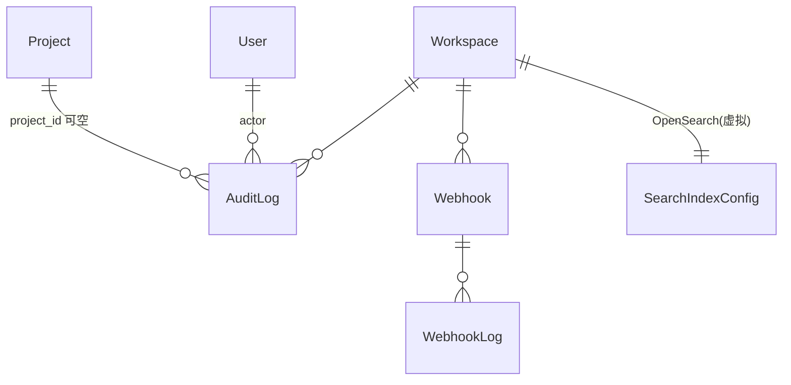

# 12. 审计日志与 EnhancedSearch（P2 方案级）

> 依据：SDK `models/v2/audit_logs.py`、`webhooks.py`、`webhook_logs.py`（高）；helm-charts plane-enterprise（OpenSearch 3.3.2 + search-index job，高）；mcp-server PQL `title~/text~`（高）。

## 实体

- **AuditLog**（workspace 级，只读）：`{id, event_id, event_name, category: auth|member|role|settings|integration|webhook|security|instance|project, outcome: success|failure, actor_id/type: user|api_token|system|anonymous, actor_display_name/email, target_id/type/display_name, old_value/new_value(JSON), metadata, reason, ip_address, user_agent, source: platform|api|graphql|auth|system, sequence_number, workspace_id, project_id, created_at}`；SDK 注释明言「hash-chain internals omitted」——**日志带哈希链防篡改**（内部字段不可见，低）。
- CE 参照：`db/models/api.py` APIActivityLog（仅 API 调用日志）——可扩展为统一审计或新建 `audit_logs` 表。
- **WebhookLog**：CE 已有 `db/models/webhook.py:65`（复用）；v2 暴露 `webhook_logs_list/retrieve` + `webhooks_regenerate`（CE Webhook 模型已有 version 字段，迁移 0113）。

## 端点

| 方法 | 路径                             | op                         | 说明                                                |
| ---- | -------------------------------- | -------------------------- | --------------------------------------------------- |
| GET  | `/workspaces/{slug}/audit-logs/` | audit_logs_list            | 过滤（category/actor/时间，`AuditLogsListFilters`） |
| GET  | `.../audit-logs/{id}/`           | audit_logs_retrieve        |                                                     |
| GET  | `.../webhook-logs/{webhook_id}/` | webhook_logs_list/retrieve |                                                     |
| POST | `.../webhooks/{id}/regenerate/`  | webhooks_regenerate        | key 重置                                            |

权限：workspace Admin；flag：无（Enterprise 档，云端按套餐门控）。

## EnhancedSearch（OpenSearch 底座）

- 官方架构：OpenSearch 3.3.2 容器 + `search-index` 初始化 job（helm values，高）。
- 追赶方案：新建 `search-index` Celery 任务把 Issue/Page 等 sync 到 OpenSearch；查询面=PQL（13 号）编译到 OS query；CE 当前全文走 Postgres（description_stripped + GIN），**过渡期可保留 PG 全文、按 flag 切换 OS**（方案级）。
- `text ~`（标题+描述）与 `title ~` 的区分说明索引字段分层（title/text 两字段，高）。

## SDK 有但 UI 未见

- AuditLog `sequence_number`（序列号→哈希链/排序）——高。
- `actor_type=api_token/anonymous`、`source=graphql`——高（证明审计覆盖非 UI 通道）。
- AuditLogsListFilters 的过滤键全集（category/outcome/actor/project）——中。

## 可信度

高：AuditLog 全字段、op、helm 架构。中：过滤参数面、CE 审计落表方式。低：哈希链内部结构、OS index mapping。
