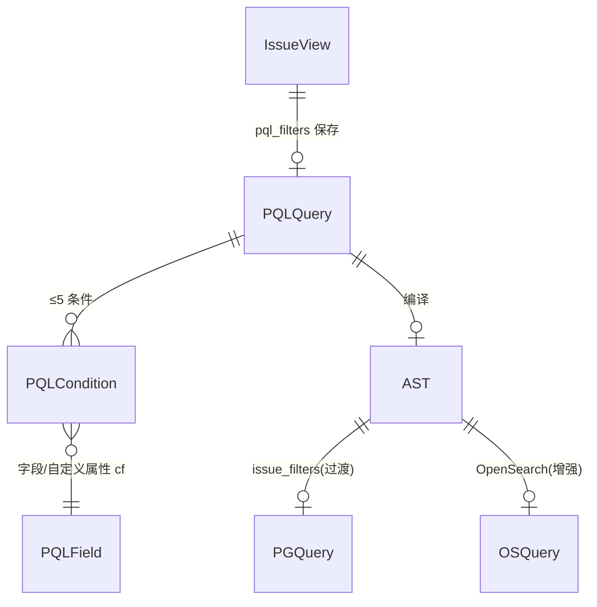

# 13. PQL 查询语言（P2 方案级）

> 依据：plane-mcp-server `plane_mcp/pql_reference.py`（MIT，完整语法参考，高）；enterprise-grid 宣传「PQL 跨组织查询」（高）；SDK v2 `pql_filters` 字段（views 模型，高）。

## 定位

PQL（Plane Query Language）是 v2 列表查询的过滤 DSL：5 个 list 工具支持 `pql` 参数（workitem/cycle/module/page 等检索）；v2 `View.pql_filters` 字段证明视图可保存 PQL；Dashboards 数据源与「AI filters」输入（59 号 Basic/PQL 双 tab）同走 PQL。

## 语法规格（摘自 pql_reference.py，高可信）

- **字段**：`priority/stateGroup/isDraft/isArchived/title/text/id/dueDate/startDate/createdAt/updatedAt`（标量）+ UUID 字段 `assignee/state/label/cycle/module/project/createdBy/type/milestone/mention/subscriber/teamspaceProject`。
- **自定义属性**：`cf["<property-uuid>"] = value | IN (...) | IS NULL`；OPTION 用 option UUID、DECIMAL 裸数、BOOLEAN 裸布尔；EMAIL/FILE/FORMULA 不可过滤。
- **运算符**：`= != > >= < <= ~ IN(...) NOT IN(...) IS [NOT] NULL/EMPTY BETWEEN..AND..`；逻辑 `AND OR NOT`（优先级 NOT>AND>OR）。
- **函数**：
  - 日期：`today/now/startOfDay.../daysAgo(n)/weeksAgo/monthsAgo/...FromNow`（无日期算术）。
  - 用户：`currentUser()/membersOf("project:<uuid>")/workspaceMembers()`。
  - 周期：`activeCycle()/completedCycles()/upcomingCycles()`；状态组：`openStates()/closedStates()/activeStates()`。
  - 谓词：`isOverdue/hasNoAssignee/hasNoLabel/isTopLevel/isSubWorkItem/isEpic/hasChildren/hasStartAndDueDates/isDraft/isArchived/isIntake`。
  - 关系：`childOf/parentOf/linkedTo/blockedBy/blocks/duplicateOf("WEB-5")`。
- **限制**：单查询最多 5 条件；不支持历史查询（wasEver/changedFrom/commentedBy）。
- 示例：`priority = "high" AND assignee = currentUser()`；`stateGroup IN openStates() AND updatedAt < daysAgo(30)`；`dueDate BETWEEN (daysAgo(7), today())`。

## 追赶实现方案（方案级）

1. **解析层**：AST（字段/运算符/函数）→ 两后端编译目标：a) Postgres（CE 过渡：映射到 `issue_filters` 现有 JSON 查询构造，`plane/utils/issue_filters.py`）；b) OpenSearch（EnhancedSearch 启用后）。
2. **UUID 解析**：`id = "WEB-11"`/`childOf("WEB-5")` 等序列号需先解析为 UUID（CE `IssueSequence` 已在）。
3. **落点**：`IssueView.rich_filters`（CE 已有 JSON 列）新增 `pql_filters` 透传；视图/自动化条件/仪表板筛选共用同一编译器。
4. 谓词/关系函数与 CE 数据模型一一对应（parent/relations/epic 均有列或桥表），无需新表。

## 可信度

高：语法全集（官方 MCP 参考原文）。中：v2 服务端 PQL 引擎与 MCP 客户端实现的差异（MCP 为客户端预编译提示，服务端原生执行面未证）。低：跨组织（跨 workspace）查询的 API 形态。
